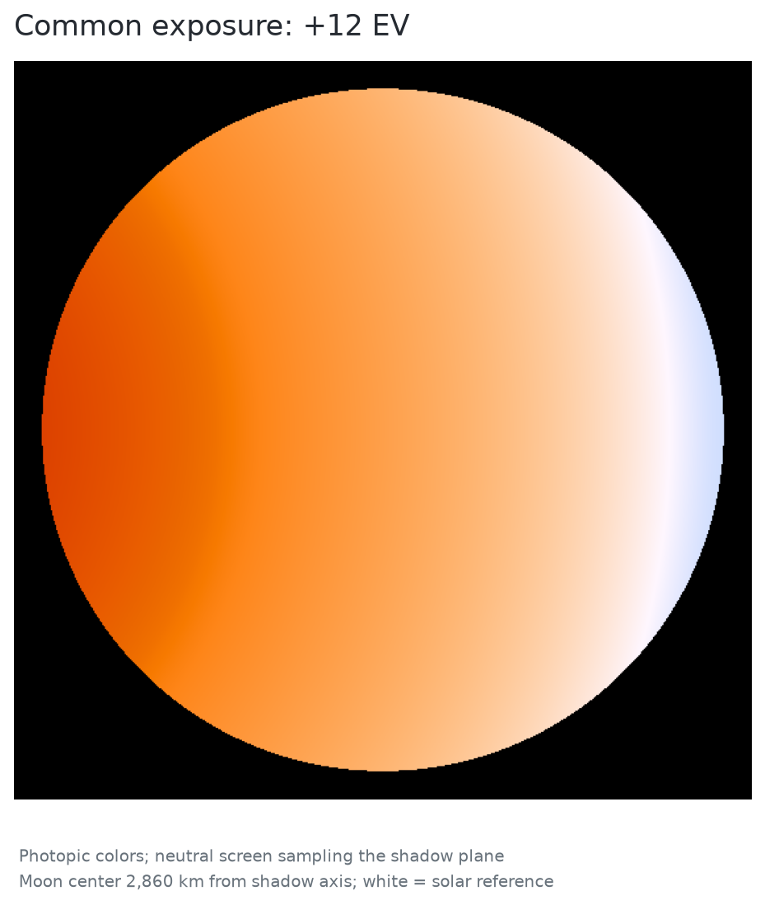

# Lunar Eclipse Color

> 中文版：[README.zh.md](README.zh.md)

Computes the spectral irradiance at the Moon's distance from the solar spectrum,
atmospheric refraction and path extinction, then renders the colors of a lunar
eclipse. The current implementation was rebuilt from scratch; earlier work is
preserved on the `legacy/*` branches and was not consulted during the rebuild.

The project is now at **v0.3: refracted transmitted light + two-layer aerosol
extinction (free troposphere 2–12 km + stratospheric background 12–35 km)**.
The internal over-brightness found by the first observational comparison has
improved, but fixed literature profiles still cannot fully explain a real
eclipse. [This round's results](docs/records/ROUND2.md) separate independent
priors, same-event calibration and unresolved residuals; the
[ROADMAP](docs/ROADMAP.zh.md) records completed milestones and the
coarse-to-fine directions ahead. Existing observations still cannot verify the
turquoise band, full visible colors, or the absolute brightness of any specific
eclipse. Work on a [multi-event reference](docs/records/MULTI_EVENT_OBSERVATIONS.md)
has begun: fixed-model comparisons against published 1990 whole-disk photometry
and December 2011 full-exposure-averaged spectra, with explicit usage conditions
for every source; no further per-eclipse tuning. The mainline narrative (what
each rung solves, methodology and the module map) lives in
[docs/MAINLINE.zh.md](docs/MAINLINE.zh.md) (English translation in
[docs/MAINLINE.en.md](docs/MAINLINE.en.md)).


*The current production two-layer default (`opac` state) neutral screen at
+12 EV; reading conventions and generational boundaries in
[figures/mainline/README.md](figures/mainline/README.md).*

## Running

Requires [uv](https://docs.astral.sh/uv/) and Python 3.12; dependencies are
pinned by `uv.lock`.

```bash
uv sync --locked
uv run lunar-eclipse simulate --out outputs/current
```

By default the model computes 380–780 nm (5 nm steps) at 0–9000 km from the
shadow axis (20 km steps), with 300 DU of ozone, a 550 nm reference refracted
path, and a fixed OPAC free-tropospheric component: 2–12 km, AOD550 = 0.013.
It is a background model from independent literature — **not a measured profile
of the 2011 eclipse and not a fitted default**. The sun-side light paths are
precomputed once; receivers use table lookups, interpolation and finite
solar-disk integration. A spectral run usually takes a few seconds. The Moon's
default position is 2860 km from the shadow axis, near the umbral edge in
mid-totality.

Beyond the literature priors there are explicit optional lanes: `--aod550` /
`--rh` adjust the free-tropospheric column and its humidity growth (the 50%
reference state stays bit-exact); `--aerosol calibrated:<name>` loads a
per-event named calibration preset — an inversion product for that event,
**calibrated, not a physical prior, and never a default**. Entry points for
the HST/STIS 2019 starborne comparison and the humidity A/B re-inversion are
under "Observational comparison" and
[validation/results/README.md](validation/results/README.md).

```bash
# First molecular model without aerosol
uv run lunar-eclipse simulate --aerosol none --out outputs/molecular

# Explicitly change the free-tropospheric column, keeping profile shape and spectral laws
uv run lunar-eclipse simulate --aod550 0.03 --out outputs/custom-aerosol

# A deeper total eclipse; move the Moon and change display exposure
uv run lunar-eclipse simulate --moon-offset-km 0 --exposure-stops 12 --out outputs/central

# Higher numerical resolution
uv run lunar-eclipse simulate --height-step-m 50 --wavelength-step-nm 2.5 --out outputs/refined
```

## Outputs

| File | Meaning |
|---|---|
| `profile.png` / `profile.csv` | Transmission, relative photopic brightness and color from umbra to penumbra |
| `spectra.png` / `spectra.npz` | Spectral irradiance with the uneclipsed solar reference and the ozone-off counterfactual |
| `rays.npz` | Tangent altitudes, impact parameters, bending, air/ozone columns, aerosol optical depths and signed landing radii |
| `moon.png` / `moon_exposures.png` | Common-exposure neutral-screen rendering plus an exposure comparison |
| `ozone_comparison.png` | Ozone on/off under identical atmosphere and exposure |
| `moon_chromaticity.png` | **Per-position equal-luminance chromaticity diagnostic, not a brightness prediction** |
| `metadata.json` / `report.json` | Model, aerosol sources, parameters, numerical grids and display rules |

Raw spectral irradiance is saved in W m⁻² nm⁻¹; image transforms never modify
it. The lunar images currently sample a uniform neutral screen over Earth's
shadow cross-section — no real lunar soil, BRDF, spherical incidence shading or
observer atmosphere yet; the aerosol is a two-layer literature prior
(free troposphere + stratospheric background), while boundary-layer and
event-specific profiles remain open directions. The current production gallery
lives in [figures/mainline](figures/mainline) with a gallery index in
[figures/README.md](figures/README.md); historical examples in
[figures/round2](figures/round2) and first-version snapshots under
[figures/baseline](figures/baseline).

## Observational comparison

The reference is the published observed curve at 503/677 nm on the western
umbra of the 2011-06-15 eclipse. It is explicitly marked as digitized from a
published figure — no raw numeric table, filter response or per-point errors —
and cannot serve as a strict bandpass prediction test. This round only added
aerosol extinction. With the fixed literature prior, the model/observation
ratio at the deepest 677 nm sample drops from about 7.10 to 3.76, and the
outermost sample moves from 1.09 to 0.97. A diagnostic calibrating AOD on
677 nm only, with 503 nm withheld as a check, also exists; it is not a default
and not an independent validation for new events.

```bash
# Current increment, candidate-cause diagnostics and explicitly labeled calibration
uv run python -m validation.round2_analysis --out outputs/round2

# First-version molecular comparison protocol
uv run python -m validation.compare_observations --out outputs/observations2011

# Photopic comparison for the added events; the 2007 extrapolation is background only
uv run python -m validation.multiple_events --out outputs/multiple-events

# December 2011: independent ephemeris, 1800 s exposure average, position sensitivity
uv run python -m validation.compare_dec2011 --out outputs/dec2011
```

[This round's comparison figure](figures/round2/comparison.png),
[analysis](docs/records/ROUND2.md), [first-round protocol and other public
data](docs/records/OBSERVATIONAL_VALIDATION.md), and [data extraction
notes](validation/observations/ugolnikov2011/README.md). This dataset does not
cover the turquoise band itself.

The [multi-event figure](figures/multiple_events/comparison.png) shows that,
for 1990 whole-disk photopic brightness, the fixed default predicts about 1.57
times the observation (molecular about 1.90). This compares a neutral lunar
screen under an approximate observational protocol; the remaining deviation
cannot yet be uniquely attributed to real atmosphere. The [December 2011 full
comparison](docs/records/DECEMBER2011.md) implements the trajectory and time
integration; the default model is still 41%–94% too bright — absolute-brightness
improvement and spectral-shape improvement do not always coincide. Full data
status, limitations and next steps: the
[multi-event notes](docs/records/MULTI_EVENT_OBSERVATIONS.md). A fixed-model
comparison against the HST/STIS 2019 starborne spectra is also complete
(blue-end slopes 0.52–0.98, over-bright direction consistent with the ground
protocols); see [validation/results/hst2019](validation/results/hst2019) and
the [source contract](validation/observations/hst2019/README.md). The humidity
A/B re-inversion verdicts are under
[validation/results/humidity_axis](validation/results/humidity_axis).

## Numerical verification and physical contract

```bash
uv run pytest -q
uv run python -m validation.check_physics --out outputs/validation/physics.json
uv run python -m validation.check_aerosol --out outputs/validation/aerosol.json
uv run python -m validation.check_convergence --out outputs/validation/convergence.json
```

Independent Cartesian ODEs, exact Bessel solutions for straight exponential
layers, whole-plane energy budgets and resolution checks verify the numerical
implementation; they do not replace observational validation. [MODEL](docs/MODEL.md)
owns the physical contract, [AEROSOL](docs/physics/AEROSOL.md) owns the new
components' formulas and sources, and [data sources](eclipse/data/SOURCES.md)
record the spectral inputs. The project runs offline and does not depend on the
sky-colour project. The model still uses a spherically symmetric standard
atmosphere, a Gaussian ozone layer, uniform solar radiance, first-order paraxial
propagation and grey refraction; clouds, boundary-layer/stratospheric aerosol
components, scattered incoming light, real 3-D weather and visual dark adaptation
are not included. These directions and their entry conditions are maintained in
the [ROADMAP](docs/ROADMAP.zh.md).
