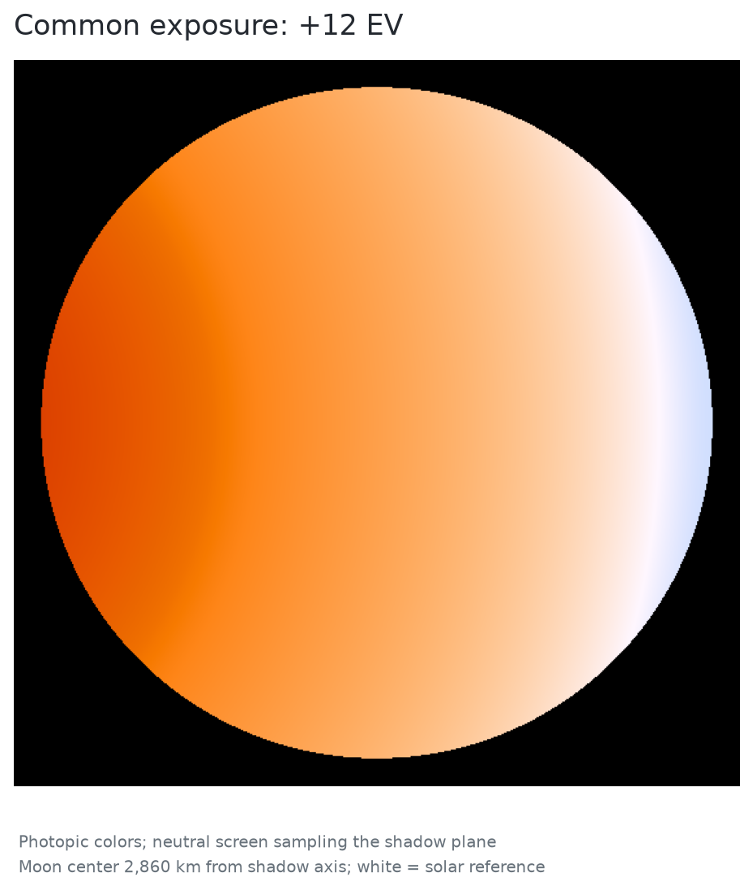

# Lunar Eclipse Color

> 英文版：[README.md](README.md)

从太阳光谱、大气折射与沿程消光，计算月球距离处的光谱照度，再显示月食的颜色。
新实现从空白重建；旧实现保留在 `legacy/*` 分支，重建时未参考旧代码。

当前为 **v0.3：折射透射光 + 双层气溶胶消光（自由对流层 2–12 km + 平流层背景 12–35 km）**。首轮观测对照发现的内部偏亮已有改善，
但固定文献廓线仍不能完整解释真实月食。[本轮结果](docs/records/ROUND2.md)区分独立先验、同事件校准和
未解决的残差；[ROADMAP](docs/ROADMAP.zh.md)记录已完成里程碑与从粗到精的后续方向。
现有观测仍不能验证绿松石带、完整可见颜色或某次月食的绝对亮度。
已开始[多事件参照](docs/records/MULTI_EVENT_OBSERVATIONS.md)：新增 1990 年整月面实测亮度的固定模型比较、
2011 年 12 月完整曝光平均的光谱比较及更多来源的使用条件，暂不继续针对单次月食调参。
主线叙事（每级阶梯解决什么、方法论与模块地图）见 [docs/MAINLINE.zh.md](docs/MAINLINE.zh.md)。


*当前生产双层默认（`opac` 态）的月面屏示意，+12 EV；读图约定与代次边界见 [figures/mainline/README.md](figures/mainline/README.md)。*

## 运行

需要 [uv](https://docs.astral.sh/uv/) 和 Python 3.12。依赖由 `uv.lock` 固定。

```bash
uv sync --locked
uv run lunar-eclipse simulate --out outputs/current
```

默认计算 380–780 nm（5 nm 间隔）、距影轴 0–9000 km（20 km 间隔），采用 300 DU 臭氧、
550 nm 参考折射路径及固定 OPAC 自由对流层组件：2–12 km、AOD550=0.013。
它是独立文献中的背景模型，**不是 2011 年月食的实测廓线，也不是拟合后的默认值**。
太阳侧光路只预计算一次，接收位置使用查表、插值与有限太阳圆盘积分。光谱计算通常只需几秒。
默认月球中心距影轴 2860 km，处在接近本影边缘的全食位置。

文献先验之外还有显式可选车道：`--aod550` / `--rh` 调整自由对流层柱量与湿度增长
（50% 参考态位精确不变）；`--aerosol calibrated:<name>` 加载按事件命名的校准预设——
它们是同事件反演产物，**校准而非物理先验，永不成为默认**。HST/STIS 2019 星载谱
对照与湿度 A/B 重反演的入口见「观测对照」与 [validation/results/README.md](validation/results/README.md)。

```bash
# 不含气溶胶的首版分子模型
uv run lunar-eclipse simulate --aerosol none --out outputs/molecular

# 明确改变自由对流层柱量，保留原有廓线形状和光谱规律
uv run lunar-eclipse simulate --aod550 0.03 --out outputs/custom-aerosol

# 更深入本影的月全食；改变月面位置和显示曝光
uv run lunar-eclipse simulate --moon-offset-km 0 --exposure-stops 12 --out outputs/central

# 提高数值分辨率
uv run lunar-eclipse simulate --height-step-m 50 --wavelength-step-nm 2.5 --out outputs/refined
```

## 输出

| 文件 | 含义 |
|---|---|
| `profile.png` / `profile.csv` | 从本影到半影的透过率、相对明视觉亮度和颜色 |
| `spectra.png` / `spectra.npz` | 光谱照度，含正常阳光参考及臭氧关闭对照 |
| `rays.npz` | 掠过高度、冲量参数、偏折、空气/臭氧柱量、气溶胶光深及带符号的落点 |
| `moon.png` / `moon_exposures.png` | 共同曝光的月面屏示意及曝光对照 |
| `ozone_comparison.png` | 相同大气与曝光下开启/关闭臭氧的对照 |
| `moon_chromaticity.png` | **逐位置等亮度的色度诊断，不代表真实亮度** |
| `metadata.json` / `report.json` | 模型、气溶胶来源、参数、数值网格和显示规则 |

原始光谱照度以 W m⁻² nm⁻¹ 保存，图像变换不会修改它。月球图目前是均匀中性屏对地影截面的采样，
尚未包含真实月壤、BRDF、球面入射角明暗和地面观察站的大气。
当前生产图组见 [figures/mainline](figures/mainline)，图组索引见 [figures/README.md](figures/README.md)；历史示例见 [figures/round2](figures/round2)，首版快照保留在 [figures/baseline](figures/baseline)。

## 观测对照

参照为 2011-06-15 西侧本影 503／677 nm 的公开观测曲线。已明确标记为论文图表数字化读数，
没有原始数值表、滤镜响应和逐点误差，不能当成严格的带通预测检验。
本轮只加入气溶胶消光。固定文献先验将最深 677 nm 采样点的模型／观测比从约 7.10 降到 3.76，
最外侧采样点从 1.09 变为 0.97。另做了仅用 677 nm 校准 AOD、用 503 nm 留出检查的诊断；
该结果不作为默认值，也不是新事件的独立验证。

```bash
# 当前增量、候选原因诊断与明确标记的校准比较
uv run python -m validation.round2_analysis --out outputs/round2

# 首版分子模型的历史比较口径
uv run python -m validation.compare_observations --out outputs/observations2011

# 新增事件的明视觉亮度比较；2007 年外推值明确仅作背景
uv run python -m validation.multiple_events --out outputs/multiple-events

# 2011 年 12 月：独立星历、1800 秒曝光平均与位置敏感性
uv run python -m validation.compare_dec2011 --out outputs/dec2011
```

[本轮对照图](figures/round2/comparison.png)、[本轮分析](docs/records/ROUND2.md)、
[首轮观测口径与其他公开资料](docs/records/OBSERVATIONAL_VALIDATION.md)、
[数据提取说明](validation/observations/ugolnikov2011/README.md)。这组数据没有覆盖绿松石带本身。

[新增事件对照图](figures/multiple_events/comparison.png)显示：1990 年整月面明视觉亮度下，
固定默认值的预测／实测约为 1.57，分子模型约为 1.90。这是中性月面与近似观测口径下的比较，
尚不能把剩余偏差唯一归于真实大气。[2011 年 12 月完整对照](docs/records/DECEMBER2011.md)已落实轨迹和时间积分，
默认模型仍偏亮约 41%–94%；它揭示了绝对亮度改善与光谱形状改善并不总是一致。
完整资料状态、限制和下一步见[多事件说明](docs/records/MULTI_EVENT_OBSERVATIONS.md)。
另已完成 HST/STIS 2019 星载谱的固定模型对照（蓝端斜率 0.52–0.98，偏亮方向与地面口径一致），
见 [validation/results/hst2019](validation/results/hst2019) 与[来源合同](validation/observations/hst2019/README.md)；
湿度 A/B 重反演的判别结论见 [validation/results/humidity_axis](validation/results/humidity_axis)。

## 数值验证与物理契约

```bash
uv run pytest -q
uv run python -m validation.check_physics --out outputs/validation/physics.json
uv run python -m validation.check_aerosol --out outputs/validation/aerosol.json
uv run python -m validation.check_convergence --out outputs/validation/convergence.json
```

独立笛卡尔 ODE、直线指数层的精确 Bessel 解、全平面能量预算和分辨率检查用于验证数值实现；
它们不代替观测验证。[MODEL](docs/MODEL.md)负责物理契约，[AEROSOL](docs/physics/AEROSOL.md)
负责新组件公式与来源，[数据来源](eclipse/data/SOURCES.md)记录光谱输入。本项目离线运行，不依赖天空项目。
当前仍采用球对称标准大气、高斯臭氧层、均匀太阳亮度、一阶小角传播和灰折射路径；
未加入云、散射入射光、真实三维天气或视觉暗适应；气溶胶现为双层文献先验（自由对流层 + 平流层背景），边界层与事件相关廓线仍是开放方向。
这些方向及其进入条件统一维护在 [ROADMAP](docs/ROADMAP.zh.md)。
