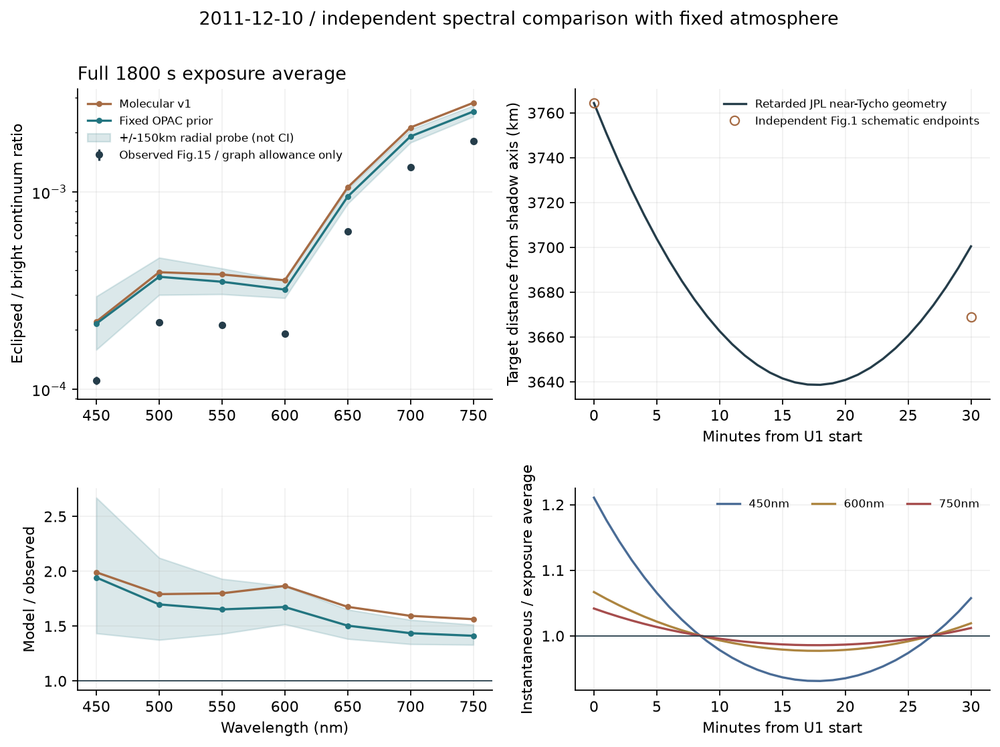

# 2011 年 12 月：完成几何与曝光平均后的独立光谱比较

此前只整理了 Yan et al. 的光谱读数，尚未完成决定可比性的几何。本次补齐星历轨迹、
独立图示核对、整段曝光积分和位置敏感性，并完成固定模型比较。模型参数没有重新标定。

结论是：在名义 Tycho 位置下，当前默认模型在七个可见连续谱点上仍比观测亮 **1.41–1.94 倍**。
气溶胶先验降低了各波长的偏亮，但并未同时改善所有光谱形状指标。
这组独立事件已进入比较；准确光纤位置未知等限制作为敏感性和使用条件保留。



## 几何怎样重建

[原论文](https://arxiv.org/pdf/1405.4780v1)第 2 节说始终指向 Tycho 附近相同月面区域，
Table 1 给出 U1 从 14:08:25 UTC 开始、持续 1800 秒。论文没有列出精确光纤经纬度，
但 Fig. 1 直接画出了观测中的位置轨迹。因此使用独立星历的代表位置，并以图示约束其合理性，
可以完成有明确前提的比较，不必等待一个未公开的准确坐标。

名义位置取 [USGS/IAU Tycho 条目](https://planetarynames.wr.usgs.gov/Feature/6163)的中心：
43.30°S、11.22°W、球面高程 0 km。[JPL Horizons](https://ssd.jpl.nasa.gov/horizons/manual.html)
直接支持月球固定坐标站点；采用 DE441 轨道和高精度 MEAN_ME 月球朝向，避免手工构造月球自转矩阵。
这不是声称光纤恰好位于撞击坑中心。

在每个反射时刻，从该月面站点请求 ICRF 下的地心和日心向量，使用 `VEC_CORR=LT`。
令 `e`、`s` 为从站点指向经光行时修正的地球、太阳的向量，向日轴 `u=(s−e)/|s−e|`，则：

\[
\rho=|e\times u|,\qquad D=e\cdot u,\qquad S=|s-e|.
\]

`ρ` 是接收点到影轴的垂直距离，`D` 是该接收平面的轴向距离，`S` 是模型所需的日地距离。
这里用实际月面站点而非月球中心，因此包含该区域的投影和月面深度。
不对物理向量再施加视位置的恒星光行差旋转，也不以作者拟合的有效切线高度来反推位置。

地面曝光时刻先减去约 1.32 秒月球至地面的光行时；站点相对地心造成的差异不超过约 0.022 秒。
这项时间近似远小于图示位置的读取尺度。地球／太阳端再各自使用 Horizons 的光行时修正，
使影轴通过传播时刻的地球，而非简单使用同一时刻的三天体位置。

每分钟采样一次，覆盖曝光两端，共 31 个节点。影轴距离 **3638.675–3764.353 km**。
保留同时时刻几何作诊断时，径向距离最多改变约 14.3 km；只替换这一径向量，
名义默认光谱最多改变约 1.25%，不足以解释主要偏亮。

## 独立核对与未知位置的处理

从固定版本 PDF 的 Fig. 1 原生位图读取：影心 `(459,328)` 像素，
U1 起止点 `(484,420)`、`(446,420)`，月球半径约 `44 ± 1.5` 像素。
采用月球物理半径换算，图示起止影轴距离约 3764.5、3668.8 km；
星历对应端点与它们相差约 **0.1、31.6 km**。

[图示读取核对图](../figures/dec2011/figure1_geometry_qa.png)标出了影心、轨迹端点与独立月球尺度，
[figure1_geometry.json](../validation/observations/yan2011dec/figure1_geometry.json)保留像素坐标、掩膜、
月缘拟合结果和源文件 SHA。该图明确是示意图，不把像素拟合精度当作真实测角精度。

据此选择 **±150 km 径向位移**作位置敏感性探针，整条曝光轨迹统一移动，不逐波长改变位置。
它不是精确光纤坐标的置信区间或完整误差包络，也没有从光谱拟合得到。
另将轴向距离单独改变 ±150 km，默认预测最大变化约 0.20%，明显小于径向变化。

## 曝光与亮度归一化

Fig. 15 已是 `(U1/B2)/300`，其中 300 为曝光时长比，不能再除一次。
B2 在 18:10:24 UTC 开始，持续 6 秒，采用曝光中点的太阳—站点距离；星历确认其完全位于地影之外。
保留 U1／B2 之间微小的太阳照度距离因子。太阳光谱、同月面光谱反照率和仪器响应的消除，
沿用论文取比值的前提；月面方向反射和观测站天气变化仍是近似。

每个节点先计算光谱比 `Tλ(t)`，再对**线性光谱照度**积分：

\[
Q_\lambda=\frac1{1800\mathrm{\ s}}\int_{t_0}^{t_0+1800\mathrm{\ s}}
T_\lambda(t)\left[\frac{d_{\odot,B2}}{d_{\odot}(t)}\right]^2dt.
\]

使用 Simpson 积分，不先平均位置、对数或颜色。只取曝光中点会使默认 450 nm 预测低约 6.3%，
750 nm 低约 1.3%；因此时间平均确实需要落实。120 秒到 60 秒采样的最大变化约 0.00033%，
光路表 100 米到 50 米的最大变化约 0.00193%。

## 比较结果与解释范围

| 波长 / nm | 观测曲线比值 | 分子模型／观测 | 固定 OPAC 默认值／观测 |
|---|---:|---:|---:|
| 450 | 1.107 × 10⁻⁴ | 1.99 | 1.94 |
| 500 | 2.188 × 10⁻⁴ | 1.79 | 1.70 |
| 550 | 2.122 × 10⁻⁴ | 1.80 | 1.65 |
| 600 | 1.911 × 10⁻⁴ | 1.87 | 1.67 |
| 650 | 6.290 × 10⁻⁴ | 1.68 | 1.50 |
| 700 | 1.330 × 10⁻³ | 1.59 | 1.44 |
| 750 | 1.809 × 10⁻³ | 1.56 | 1.41 |

即使取本轮 ±150 km 探针中预测较暗的一端，默认模型在各点仍至少偏亮约 33%。
这说明在所检查的位置范围内，位置差异不足以单独消除亮度残差；不是对所有可能观测系统误差的排除。

名义位置下，450／750 nm 的透射比之比为 1.38，即默认模型相对观测的蓝／红比偏高约 38%；
分子模型该值约 1.27。自由对流层消光使绝对亮度更接近，同时对红光的相对影响更大，
因而这个形状指标反而变差。该指标对位置敏感：在统一位移的探针中约为 1.08–1.77，
不能把名义 38% 当作与几何无关的精确物理偏差，更不能直接称为月面颜色误差。

结合 1990 年默认模型约偏亮 57%、2011 年 6 月局部曲线的残差，当前结论应是：
简单背景气溶胶有跨事件的亮度收益，但尚未同时解释不同事件的亮度与光谱形状。
不能继续把单次红波段标定的 AOD 当作通用改进，也不能仅凭事件大气不同就忽略一致的偏亮方向。
这里不增加任何物理参数来消除新残差。

七个图表读数不是独立曝光，图中的误差线仅代表图形读取裕量，不是观测测量误差。
模型仍省略 NO₂、O₂／碰撞吸收、水汽谱线、月面 BRDF、太阳临边昏暗及实际三维大气；
选取连续谱点避开主要 O₂ 强带，不代表所有弱谱线和系统误差已消除。
本次完成的是有条件的跨事件连续谱比较，不是完整颜色或绿松石带验证。

## 复现与检查

```bash
# 离线：完整几何、时间平均、敏感性和比较
uv run python -m validation.compare_dec2011 --out outputs/dec2011

# 可选联网：重新请求星历；来源参数、响应 SHA 与节点记录均保留
uv run python tools/fetch_dec2011_geometry.py

# 可选：从固定 PDF 重新核验 Fig.1 像素锚点并生成标记图
uv run --with pymupdf==2.1 python tools/extract_yan2011.py --geometry-qa outputs/dec2011/figure1_geometry_qa.png
```

[比较 CSV](../validation/results/dec2011/comparison.csv)、
[逐时刻光谱 CSV](../validation/results/dec2011/time_samples.csv)、
[完整结果与诊断 JSON](../validation/results/dec2011/comparison.json)均已落盘。
105 项测试通过；独立物理、气溶胶守恒和分辨率检查通过。
