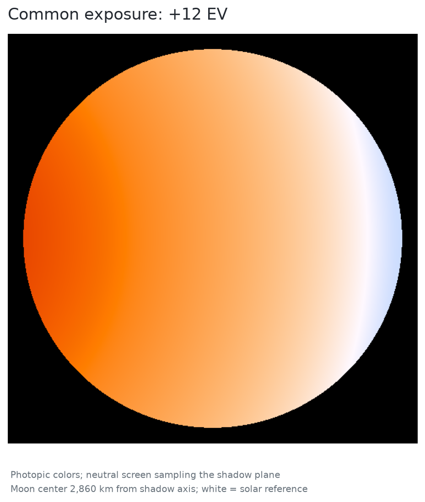
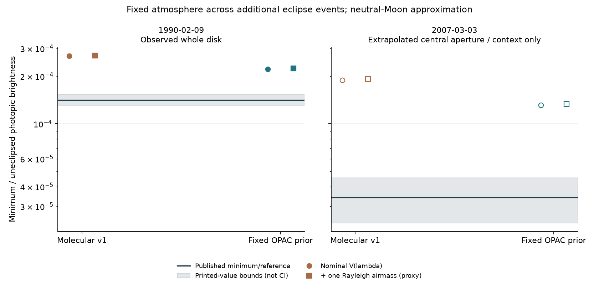
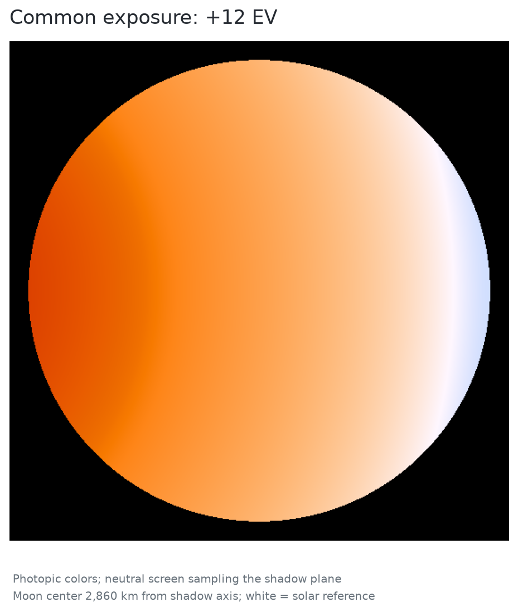
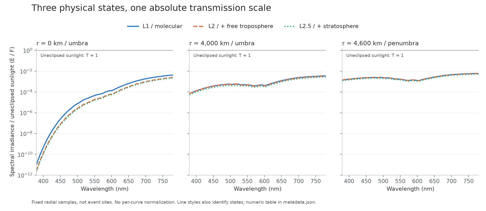
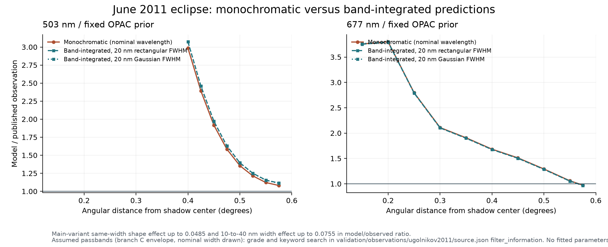
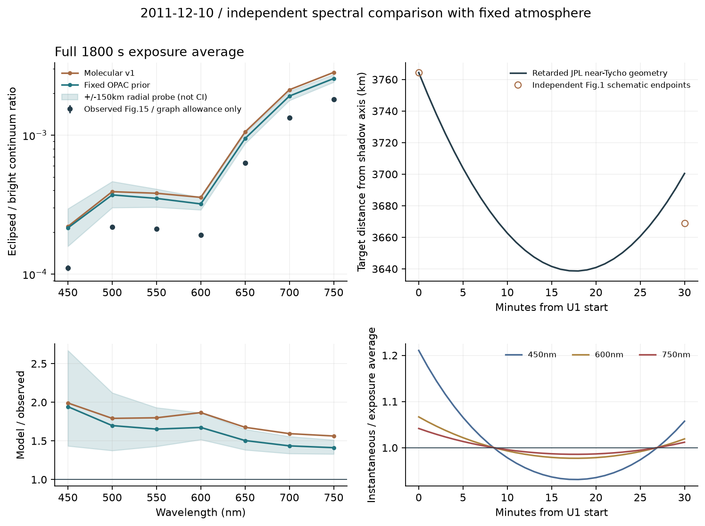
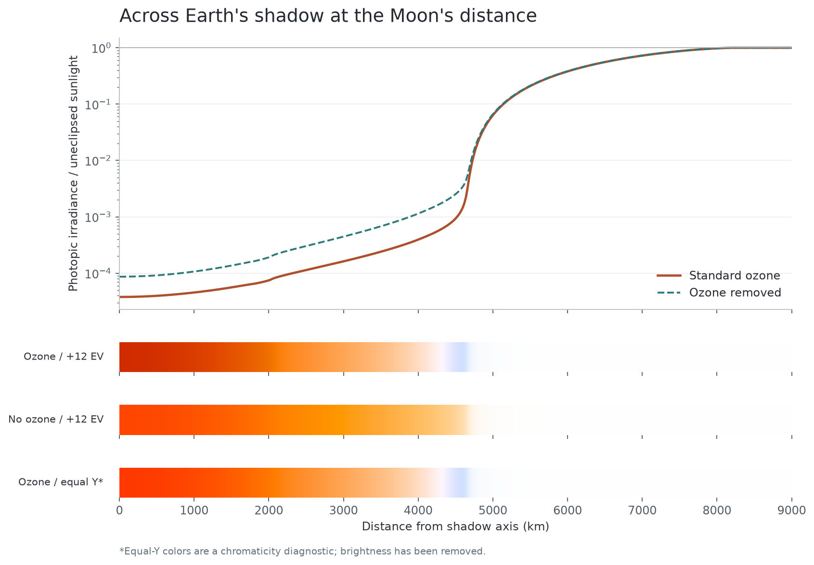

# The lunar-eclipse color mainline: from computing the light correctly to explaining the observations

> Chinese original: [MAINLINE.zh.md](MAINLINE.zh.md) — **authoritative version**;
> this translation may lag behind it.

Why is the Moon not fully dark when Earth blocks the Sun? Why does the lunar
disk turn red, and why can the shadow's edge turn cold? Starting from the solar
spectrum, this project first computes the light arriving at the Moon, then asks
whether it explains real eclipses — it does not pick colors from photographs
and reverse-engineer an atmosphere.

## Division of labor and reader routes

This document owns the **ladder abstraction, the methodology narrative, the
module map and the question skeleton for future writing**; it owns no second
physical contract, parameter table or execution ledger.

| Question | The single authoritative entry | How this document uses it |
|---|---|---|
| Where are we, and when is the next step worth taking? | [ROADMAP](ROADMAP.zh.md) | Explains the advancement logic; does not copy the milestone table or schedule |
| What is being computed, and which approximations must be kept? | [MODEL](MODEL.md) | Explains what each layer solves; does not redefine formulas or tolerances |
| How is the aerosol composed, and where does humidity act? | [AEROSOL](physics/AEROSOL.md) | Links the component contract; does not re-copy parameters or interface rules |
| Where does the data come from, and what is a calibrated value's identity? | [SOURCES](../eclipse/data/SOURCES.md) | Keeps the source boundary between priors and fits |
| What are the numbers, exactly? | [Committed products](../validation/results/README.md) and the per-item fields below | **Zero hand-copied numbers**: conclusions pin to generated fields, no numeric duplicates maintained |
| How does the code carry the roadmap? | [AGENTS](../AGENTS.md) and the module map below | Compare against actual responsibilities; an observation is not a refactoring mandate |

Reading order: start with "what is computed", then walk the physical ladder;
jump to the module map if you only want code, or to the narrative hooks if you
are preparing an article. The L labels in the text are explanation levels —
not ROADMAP milestone numbers and not runtime switches. Event names, band
identifiers, units, levels and commands are not a new results ledger. "Default"
in historical documents must be read under that round's conditions: the early
`fixed_opac` was a free-troposphere single layer and must not be silently read
as today's two-layer default; the variant identities of the two-layer rerun are
pinned in [the production-prediction definition](../validation/results/stratosphere_background/predictions.json).

The new three-state disks, transmission spectra and profile come from the
current production CLI; the three disks share one geometry, size and global
+12 EV, with no per-state brightening. This is a neutral lunar screen — not a
photograph or a brightness fit — and the highlight compression also means
pixel values cannot be read directly as irradiance ratios. Reading conventions:
[the figure-group README](../figures/mainline/README.md); the sole parameter
and provenance ledger: [the group metadata](../figures/mainline/metadata.json).
Observational figures still reference historical single-layer snapshots with
per-figure generation labels; they must not be mixed with the new figures as
same-state validation.

## What is computed: keep the spectrum first, then talk about colors

The main output is the **spectral irradiance** on the plane through the Moon,
perpendicular to the Sun–Earth axis — not the lunar radiance a telescope
receives. A spherically symmetric atmosphere makes it a radial light field: the
Sun's finite disk supplies beams of incident light, Earth blocks part of them,
refraction bends some limb-grazing light into the geometric shadow, and
extinction decides how much of each wavelength survives. [MODEL's computed
quantity and transport contract](MODEL.md#quantity-being-computed) gives the
strict definition.

The current lunar image is a neutral screen sampling that illumination field.
The evidence identities of spectra, photometric quantities, common-exposure
images and equal-luminance chromaticity diagnostics differ; brightening dark
regions helps read spectral shapes, but the brightened image must not be read
as a brightness prediction. That is why the following three lanes stay
separate: **the default physics ladder, the calibration/validation lanes, and
the rendering axis**.

## The ladder: what each rung adds, and what it leaves open

### L0 — Numerical correctness: did we solve the declared model first?

- **New physics**: none added to the atmosphere. This is the verification
  foundation shared by all rungs, not a certificate of full atmospheric realism.
- **Discriminating evidence**: an independent Cartesian ODE checks the bent
  paths and columns; a no-atmosphere limit checks the occultation geometry;
  a whole-receiver-plane energy budget does not depend on where light lands.
  [The physics check](../validation/results/physics.json), [the aerosol-path
  check](../validation/results/aerosol.json) and [the resolution
  check](../validation/results/convergence.json) each store their parameters
  and results; the [independent tests](../tests/test_independent_physics.py)
  are not same-shaped copies of the production formulas.
- **What it explains**: when the model is too bright, why can the error not be
  assigned to the atmosphere immediately? First exclude implementation errors
  in the paths, both-sided columns, landing branches and annular energy.
- **Boundary**: the ODEs still share the declared molecular medium. Different
  equations and integrators can verify the transport, but cannot prove this
  medium is any real eclipse's atmosphere; grid convergence is not observational
  agreement either.

### L1 — Molecular atmosphere: the red umbra and the cold edge

- **New physics**: on top of the geometric occultation by an opaque Earth,
  molecular refraction, Rayleigh extinction and ozone absorption.
  Light travels the full both-sided bent path, then transport applies the
  finite solar disk and conserved annular weights; dispersion, scattered-in
  light and other boundaries defer to [MODEL](MODEL.md).
- **Discriminating evidence**: the ozone-off counterfactual on the same light
  paths makes the molecular baseline's shallow cold edge disappear — see
  [MODEL's mechanism and scope](MODEL.md#references-and-next-discriminating-experiments)
  and the [baseline figures](../figures/baseline). But the [first-round
  comparison](records/OBSERVATIONAL_VALIDATION.md#首版分子模型结论) shows a
  systematic internal over-brightness.
- **What it explains**: refraction keeps the geometric umbra illuminated, and
  short-wave extinction on long grazing paths reddens the interior; ozone's
  selective absorption can reshape the outer-edge spectrum — "all blue light is
  scattered away" cannot explain every position.
- **Boundary**: unscattered light is computed. The cold-edge mechanism does not
  mean the observed turquoise band is verified; its width, saturation and
  absolute brightness still need band- and position-resolved observations.


**Figure 1 · The neutral lunar screen under the molecular atmosphere, current
production CLI, uniform +12 EV.**
**What to look at**: from the warm axis-side colors to the outer shallow-cool
tones, the image shows one radial illumination field's spatial sampling. It is
not a lunar photograph, and the observational identity of the cold edge remains
bounded above; compare with Figures 2 and 4 at the same exposure.

### L2 — Free-tropospheric aerosol: make the increment hit the heights that actually deliver light

- **New physics**: independently sourced free-tropospheric extinction added to
  the existing gas light paths — gas refraction geometry unchanged, no
  scattered-into-receiver light added. The component and zero-restoration
  semantics are defined only in [AEROSOL](physics/AEROSOL.md).
- **Discriminating evidence**: [the second round](records/ROUND2.md) first
  separated candidates with contribution heights, solar limb darkening and
  density probes, then selected the literature prior. The [round analysis](../validation/results/round2/analysis.json)'s
  `selected_increment` and `identification_scope` pin the choice and its
  evidence grade; this document does not duplicate the round's comparison numbers.
- **What it explains**: why can extra extinction preferentially darken the
  deep umbra, while a near-surface boundary-layer preset cannot be substituted
  at will? The key is which grazing paths still deliver light into the
  receiver aperture — not how hazy the ground looks.
- **Boundary**: the benefit is not a unique causal attribution and does not
  close the over-brightness. The [cross-event comparison](records/MULTI_EVENT_OBSERVATIONS.md)
  widened the test: brightness can improve while the nominal blue/red shape
  worsens; the historical single-layer prior is not any event's measured profile.



**Figure 2 · The current CLI's FT single-layer state, same geometry, size and
+12 EV as Figure 1.**
**What to look at**: the axis-side darkens after the extinction is added;
shallow highlights are subject to the common compression, so the benefit cannot
be measured from display pixels alone. This visualizes the increment — it is
not an atmospheric attribution for any real eclipse.



**Figure 3 · Historical v0.2 molecular/FT single-layer comparison — not the
current two-layer or the humidity A/B.**
1990 is whole-disk photopic photometry; 2007 is the central field's
extrapolated minimum, background only. The shading spans the corner range of
the published ± values, **not a confidence interval**.
**What to look at**: in the left panel the prior point drops relative to the
molecular point yet stays above the observed reference; the right panel's
title says `context only` explicitly — it is not a second independent measured
minimum.

### L2.5 — Stratospheric background: complete the evidence-backed high-layer extinction, do not declare brightness closed

- **New physics**: the same-source literature stratospheric background joins
  the free troposphere as a layered aerosol column, each layer keeping its own
  path optical depth and spectral law. This is not scaling up a single-layer
  AOD, nor collapsing two layers into one effective spectral slope.
- **Discriminating evidence**: in the [discrimination
  table](../validation/results/extinction_gap_diagnosis/discrimination.json),
  `discrimination.json:candidates.stratosphere_background.events.*.brightness.verdict`
  shows every protocol's brightness still in the tension band. It improves the
  listed shape metrics for June/Dec while slightly worsening HST's listed
  slopes — check
  `discrimination.json:candidates.stratosphere_background.events.dec_2011.shape` and
  `discrimination.json:candidates.stratosphere_background.events.hst_2019.shape`
  item by item; "all shapes improved" would be an over-summary. The
  [preregistered check](../validation/results/stratosphere_background/preregistered_check.json)'s
  `preregistered_check.json:verdict` tests whether the probe predictions and
  the production implementation agree.
- **What it explains**: why can higher-layer extinction correct the blue/red
  shape better than more low-layer extinction? It hits a different height mass
  of the per-wavelength contribution kernels.
- **Boundary**: the [standing-gap ruling](physics/AEROSOL.md#evidence-and-interpretation)
  still holds: this component does not close the brightness residual. The broad
  low-layer proxy darkens but carries a shape cost and a menu-selection effect;
  "it is darker" is not an entry reason.



**Figure 4 · The current production two-layer background, sharing +12 EV with
Figures 1 and 2.**
**What to look at**: the warm interior and shallow-cool outer edge are still
visible; the visible difference from the FT single layer is limited — the disk
itself cannot adjudicate whether the residual is closed. No fitted states here,
and images do not substitute for the brightness and shape fields above.



**Figure 5 · The three states' transmission spectra on one CLI grid; the
vertical axis is dimensionless E/F, the horizontal axis wavelength in nm.**
**What to look at**: the axis panel's spectrum tilts strongly toward long
wavelengths, the outer panels are flatter; within each panel the absolute
amplitude change from added extinction is readable. All facets share the
logarithmic vertical axis and the uneclipsed `T = 1` reference — no per-curve
peak normalization, no equal-Y. The three radii are display samples only; the
rightmost point sits in the penumbra under this geometry, not an in-umbra
station; the numeric table is read back from the group metadata.

### The calibration lane — align the measurement protocol first, then ask what closure requires

- **New physics**: this lane adds no production-default physics. Bandpass
  integration belongs to observable matching; the cross-event inversion and
  `calibrated:` presets are fits and explicit display. Humidity growth is
  sourced and optional on the FT component, but per-event root-finding remains
  calibration — a physical-sounding name does not make it an independent prediction.
- **Discriminating evidence**:
  - **Protocol first**: the [filter augmentation](records/OBSERVATIONAL_VALIDATION.md#滤镜带通口径2026-11-增补)
    uses an assumed bandpass envelope, not a measured response. The [bandpass
    products](../validation/results/filter_response_2011/analysis.json) share
    their basename with another in-repo `analysis.json`, so only an explicit
    file link is given here, no ambiguous field citation. The deep residual is
    not explained by the measured bandpass effect; the outermost point changes
    only marginally; the direction must separate the fixed prior from the
    molecular variant.

    

    **Figure 6 · The June historical FT single-layer main variant's bandpass
    protocol probe — not the current two layers or a measured filter response.**
    The band in the figure is an **assumed response envelope**; the observation
    is a figure readout, the readout margin is not measurement error, and other
    variants live in the original products. **What to look at**: the main
    variant's monochromatic/bandpass curves sit close together and the deep
    point stays far from `model / observation = 1`; filter unknownness is not
    thereby solved.

  - **Required atmosphere**: the [cross-event inversion](../validation/results/atmosphere_inversion/inversion.json)
    root-finds fixed increment shapes on the two-layer baseline.
    `inversion.json:preregistered` owns the fit/withhold split and criteria;
    `inversion.json:cross_event.verdict` keeps the cross-event tension, and
    `inversion.json:cross_event.prediction_matrix` checks what happens when one
    event's increment is applied to another. The [registry](../eclipse/data/calibrated_presets.json)
    labels the results `calibrated_not_physical_prior`; it does not replace the
    default.

    

    **Figure 7 · The Dec2011 historical molecular/FT single-layer fixed model,
    full-exposure average at the nominal Tycho site.**
    The observed points are figure-continuum readouts; readout margins do not
    impersonate measurement errors, and the radial-position probe is not a
    confidence interval. **What to look at**: the upper-right trajectory and
    the lower-right "instantaneous / exposure-averaged" panels show why a
    single epoch cannot stand in for the full exposure; the lower-left keeps
    the fixed model's residuals against the readouts. It is not the current
    two-layer state, the humidity A/B, or a post-inversion fitted figure.

  - **Humidity A/B**: component data recovered by the [source survey](records/PRIOR_SOURCE_SURVEY.md)
    enters the FT scalar growth axis through the [humidity-prior
    transcription](../validation/results/prior_source_survey/humidity_axis_priors.json).
    `humidity_axis_priors.json:q_rest_derivation` records the subtraction
    constraint on the non-growing remainder, and
    `humidity_axis_priors.json:layer_scope_rulings` bounds the stratospheric
    and calibrated-increment layers out of this humidity axis. The [A/B
    products](../validation/results/humidity_axis/inversion_ab.json)'s
    `inversion_ab.json:b50_reproduction_gate.verdict` first pins exact
    reproduction of the original inversion at the reference band. A root-finds
    RH only: `inversion_ab.json:humidity_sufficiency.model_verdict.per_event.*.verdict`
    shows each event's fitted subset can close within the declared domain; B
    fixes humidity bands and then root-finds the remaining increment —
    `inversion_ab.json:variant_b.ladder`, `inversion_ab.json:r_rh` and
    `inversion_ab.json:share_table` together keep the states, participating
    events and shares.
- **What it explains**: can the brightness gap left by fixed priors be absorbed
  inside the model by one source-constrained direction? A gives per-event
  closure demand, B gives the remaining increment at the same humidity band.
  The mid-band cross-event spread is still judged tense; the high bands are all
  `over_closed` and the spread is judged `degenerate` — not "no increment
  needed, so the generic model passes".
- **Boundary**: a share measurement is not a causal attribution, and an RH
  root is not an observed event humidity.
  `inversion_ab.json:humidity_sufficiency.preregistered_proxy` is the linear
  AOD budget proxy falsified by the machine results, kept for audit only;
  `inversion_ab.json:humidity_sufficiency.model_verdict` carries the
  in-model sufficiency. A's withhold and shape accounts still require
  `inversion_ab.json:variant_a.june_2011.shape`,
  `inversion_ab.json:variant_a.dec_2011.shape` and
  `inversion_ab.json:variant_a.hst_2019.shape` — fitting closure alone is not
  enough. The [sensitivity appendix](../validation/results/humidity_axis/inversion_ab.json)'s
  `inversion_ab.json:sensitivity_appendix` keeps the interpolation choices,
  the scalar axis's spectral-shape omission and the independent-weather
  verification gap; this document does not re-judge the standing gap.

### L3+ — Event-specific profiles, clouds, 3-D structure and scattering: directions not yet implemented

- **New physics**: this section has no implemented new component, and it does
  not fuse these directions into one promised "big model".
- **Discriminating evidence**: [the ROADMAP's entry conditions](ROADMAP.zh.md#后续方向与进入条件)
  own the gap each direction must answer: position/absorption-shape residuals
  push real gas-profile checks, directional asymmetry pushes 3-D weather
  constraints, weak-transmission regimes trigger the scattered-in-light
  discrimination, and multiple scattering is judged separately afterwards.
- **What it explains**: which class of residual and available observation
  should pick the next round — not nominal complexity? Event-specific
  atmosphere, source structure and observational protocol are discriminable
  candidates, not mutually compensating knobs.
- **Boundary**: without independent data matched in time and position, giving
  every eclipse more parameters only widens the fitting space; added
  scattered-in light cannot solve the existing over-brightness alone either.
  Entry conditions are not an implementation schedule.

### The rendering axis — lunar screen, BRDF, observer and display: orthogonal to the validation lanes

- **New physics**: currently only the neutral screen and the
  chromaticity/display transforms; real lunar-soil reflection, BRDF and
  observer conditions are directions, not this implementation.
- **Discriminating evidence**: [MODEL's display contract](MODEL.md#color-and-display)
  separates common exposure from the equal-Y diagnostic, and [the ROADMAP's
  surface and vision directions](ROADMAP.zh.md#后续方向与进入条件) plus [the
  texture direction](ROADMAP.zh.md#月面贴图的实现方向) separate real reflection
  from display approximation.
- **What it explains**: how can one illumination spectrum produce different
  appearances? Lunar-region weights, reflection direction, camera or observer,
  exposure and display all intervene.
- **Boundary**: texture, white-point or exposure changes are not new
  atmospheric evidence; a calibrated preset's pretty image is still a
  calibrated image. The illumination field must remain readable separately
  from any image.



**Figure 8 · The current two-layer state's radial photopic irradiance and
production color strips; the horizontal axis is shadow-axis distance in km,
the vertical axis the uneclipsed-solar Y ratio.**
**What to look at**: irradiance rises quickly from the dark umbra into the
penumbra; the ozone on/off strips at the common +12 EV help locate the cold-toned
spectral change. `ozone-off` changes absorption only — refraction and the rest
of the medium are unchanged; the last **equal-Y strip has brightness removed at
every radius: a chromaticity diagnostic, not a brightness prediction**.
Do not substitute the equal-Y strip's vividness for the photometric curve above.

## Methodology: what drives the ladder is discriminating power, not the pictures

### Probes before physics: first confirm the candidate can reach the gap

Principle: do not build a complete component and then hunt for reasons to keep
it — first check, with same-protocol counterfactuals, what it can change.
Example: in the [gap discrimination](records/OBSERVATIONAL_VALIDATION.md#判别探针与相容性排序),
the common shallow-boundary-layer types are all excluded-leaning on event-level
brightness — but that does not mean the deepest single point is untouched.
Compare
`discrimination.json:candidates.continental_clean.events.*.brightness.verdict`
with
`discrimination.json:candidates.continental_clean.events.june_2011.brightness.max_readout_gap_closure_fraction`.
What is falsified is "these shallow priors suffice for each protocol's main
gap", not "Earth has no boundary layer".

### Preregistration: the production implementation may not tune toward the expected result

Principle: pin the prediction target, criteria and tolerances first, then let
another execution path accept the check. Example: before the stratospheric
probe entered the default, the discrimination table's values were already the
prediction; the production layered implementation's check lives in
`preregistered_check.json:rows`, the measured differences in
`preregistered_check.json:measured_max_absolute_diff`, and the tolerance rule
in `preregistered_check.json:tolerance_definition` — never back-derived from
the measured differences. This consistency check supports "the implemented
increment matches the prediction"; it is not two fully independent pieces of
physical evidence: the probe and production still share part of the medium and
light-path machinery.

### Three evidence identities: independent prior, same-event calibration, independent prediction

Principle: where a parameter comes from, and where the result is tested, are
two different things. Example: the OPAC background prior comes from independent
sources; the [second round's red-band calibration with the blue band withheld](records/ROUND2.md#效果与仍然存在的残差)
is still a same-event check; only the [multi-event fixed-model comparison](records/MULTI_EVENT_OBSERVATIONS.md)
provides different events' tests. The [prior survey's coverage
matrix](../validation/results/prior_source_survey/coverage_matrix.json) states
which dimensions a source covers — it does not authorize picking a new default.
The humidity growth's independent source likewise does not make the fitted
per-event RH values independent.

### The two-axis mechanism: contribution-kernel height distribution × composition action band

Principle: you cannot guess the receiver-side color change from a particle's
spectral slope alone; first ask from which paths each wavelength's light
arrives. Example: in the [mechanism analysis](records/OBSERVATIONAL_VALIDATION.md#机制发现形状响应由高度选择性决定),
December's blue and red contribution kernels carry different low-layer mass.
The [height products](../validation/results/extinction_gap_diagnosis/height_stats.json)'s
`height_stats.json:kernel_identity` defines the kernel and height-band
semantics, and `height_stats.json:summary.worst_relative_gap` checks the
zeroth moment against the original prediction; the kernels' height
distributions are not measured atmospheric profiles. A low-layer increment
preferentially weakens the red kernels it hits; a high-layer increment hits
more blue kernels — opposite blue/red changes can result. The humidity
machine's `inversion_ab.json:humidity_sufficiency.effectiveness` adds: equal
vertical AOD increments across layers are not equivalent, and a linear budget
cannot adjudicate nonlinear transport closure.

### The cross-event final word: same-direction evidence is not every metric improving together

Principle: a candidate must carry its unresolved residuals across protocols;
one fitted curve does not close a case. Example: the June local curve, the HST
starborne spectrum, the December exposure-averaged spectrum and the 1990
whole-disk photometry keep their common over-bright direction in the
[correlation table](../validation/results/extinction_gap_diagnosis/correlation.json)'s
`correlation.json:event_level.*.fixed_opac.residual_ln_ratio_median`;
`correlation.json:cross_event` reports the depth ordering, with sample size
insufficient for strong causal claims. "Same direction" refers to this
brightness-residual/improvement evidence, not all shape and withhold metrics
passing for every event. The four protocols are also not a homogeneous sample
that can be freely fused into one color-error score.

## Module map: the ladder is not the directory order, the lanes are not display styles

### The production chain and its data-consumption boundary

Read the table in [AGENTS](../AGENTS.md)'s responsibility order; it does not
claim only-adjacent calls are legal. For example `rays` consumes both medium
and spectra, `cli` orchestrates across layers, and `color` reads `spectra`'s
color-matching functions directly.

| Module / source | Responsibility | Rung / lane | Why it sits here |
|---|---|---|---|
| [spectra.py](../eclipse/spectra.py) | Solar spectrum, CIE, ozone cross-section tables and molecular-optics formulas | L1 base inputs; colorimetry shared | Wavelength-dependent data must not decide height profiles, receiver geometry or exposure |
| [atmosphere.py](../eclipse/atmosphere.py) | Molecular density and gradients, independently normalized ozone height profile | L1 medium | Defines the height structure; carries no aerosol humidity or per-event inversion |
| [aerosol.py](../eclipse/aerosol.py) | Finite-layer extinction, per-layer spectral laws, column composition and FT humidity growth | L2/L2.5; optional humidity physics | A removable extinction component must not modify gas refraction, nor perform observational fits |
| [rays.py](../eclipse/rays.py) | Both-sided bent paths, gas columns and per-layer aerosol optical-depth tables | L1–L2.5; the L0 verified object | Builds forward tables independent of receiver radius from the medium; no lunar sampling yet |
| [transport.py](../eclipse/transport.py) | Finite Sun, full landing branches, conserved receiver integration and the spectral solve | L1–L2.5 transport | Combines paths and receiver geometry at physical quantities; applies no display clipping |
| [color.py](../eclipse/color.py) | Spectra to physical XYZ/Y, plus chromatic adaptation, RGB and the display transform | Photometric interface × rendering axis | One file spans the photometric/display interface — not all of its outputs are display quantities, nor all photometric |
| [report.py](../eclipse/report.py) | Input validation, relative-Y diagnostics, profile/disk figures and the report JSON | Scientific reporting × rendering axis | Derives diagnostics and reports from existing spectra; no tracing or inversion; not display-only |
| [cli.py](../eclipse/cli.py) | Argument validation, medium/geometry construction, solve orchestration and raw products | Default / explicit calibration / rendering entry | The application layer picks a lane and saves provenance; it never slips fits into medium defaults |
| [calibrated_presets.json](../eclipse/data/calibrated_presets.json) | The per-event-named consumption registry of calibrated atmospheres | Calibration data layer | Read only on explicit CLI selection; the event mapping lives in the registry's `event` field; the inversion machinery does not move into the production package |

The package-level [__main__.py](../eclipse/__main__.py) forwards to the CLI and
[__init__.py](../eclipse/__init__.py) carries package metadata; neither is an
extra physics layer. The registry carries the inversion products' source
hashes; actual values/shapes/splits are verified by the [registry-anchoring
tests](../tests/test_atmosphere_inversion.py); runtime loading is not a
re-inversion or a live re-hash of source files. What is checked here is the
source-tree consumption path — no claim that the distribution package has been
accepted.

### The verification machinery: independent numerical checks, observational aggregation and the research ledger

| Entry / source | Responsibility | Rung / lane | Why it stays in validation |
|---|---|---|---|
| [check_physics](../validation/check_physics.py) | Cartesian ODE, geometric/landing fold and whole-plane flux closure | L0 | Independent reference equations verify production transport; they are not another production path |
| [check_aerosol](../validation/check_aerosol.py) | Bessel straight-line reference, independent curved-path ODE, layered flux checks | L0 × L2/L2.5 | Component-path correctness needs different numerical chains; display figures must not self-certify it |
| [check_convergence](../validation/check_convergence.py) | Height and spectral resolution refined separately, photopic and chromatic errors kept apart | L0 × rendering diagnostics | Numerical precision validates the declared model; it is not new physics |
| [compare_observations](../validation/compare_observations.py) | June molecular baseline, geometry/ozone/grid probes and observed readouts | L1 fixed comparison | Specific figure protocols and historical conditions must not enter the default solver |
| [round2_analysis](../validation/round2_analysis.py) | FT increment discrimination, limb-darkening/density probes, red-band calibration with blue withheld | L2 evidence; same-event calibration | One script keeps fixed-prior and fitted accounts separate; they must not be called independent prediction together |
| [filter_response_2011](../validation/filter_response_2011.py) | Bandpass kernels, assumed response envelopes and monochrome-set reproduction | Observational protocol | It changes the comparable quantity, not the atmosphere; filter unknownness stays independently tracked |
| [compare_dec2011](../validation/compare_dec2011.py) | Full exposure average of linear spectra, geometry and position sensitivity | Fixed comparison | Exposure aggregation is an observational operator; averaged colors cannot substitute |
| [compare_hst2019](../validation/compare_hst2019.py) | Raw STIS FITS extraction, whole-Moon reference and exposure-weighted comparison | Starborne fixed comparison | Receiver, instrument and sampling drift belong to this dataset's comparability |
| [multiple_events](../validation/multiple_events.py) | Offset-aperture/disk averaging and visual photometry | Fixed comparison | Whole-disk and local readouts are not one protocol; extrapolated background and measurements stay separate |
| [extinction_gap_diagnosis](../validation/extinction_gap_diagnosis.py) | Four-protocol contribution kernels, height statistics, correlation and literature candidate probes; production two-layer rerun | L2→L2.5 discrimination | Depends on observational aggregation and committed baselines; the current height-diagnosis single source, not a second transport |
| [atmosphere_inversion](../validation/atmosphere_inversion.py) | Per-event increment root-finding on the two-layer baseline, withhold, shapes, prediction matrix | Calibration lane | Targets and splits depend on observations; it must not become a default-medium factory |
| [humidity_axis_inversion](../validation/humidity_axis_inversion.py) | A's RH root-finding, B's humidity-ladder residual increments and the share ledger | Humidity calibration research | Calls the production humidity component and the existing inversion machine; study design does not define default physics |

Helpers are reused by semantics, not migrated by length: the current
contribution kernels live in `extinction_gap_diagnosis`, exposure averaging in
`compare_dec2011`, band aggregation in `compare_hst2019`, aperture and
photometric weights in `multiple_events`. `round2_analysis`'s height
percentiles remain a historical generator and anchor, not a second general
height diagnostic. The humidity inversion reuses `atmosphere_inversion`
rather than writing a near-identical objective.

### Data acquisition and transcription: not production or calibration solving

| tools entry / source | Responsibility and lane | Why it lives in tools |
|---|---|---|
| [extract_ugolnikov2011.py](../tools/extract_ugolnikov2011.py) | Fixed PDF vector-curve transcription with filter-information branch checks; the June observational input | Acquisition/transcription has its own source contract; it does not go online during the propagation solve |
| [fetch_eclipse2011_geometry.py](../tools/fetch_eclipse2011_geometry.py) | Horizons Sun–Moon distances for June | External geometry data is a fixed-comparison input, not inverted from brightness |
| [extract_yan2011.py](../tools/extract_yan2011.py) | Fixed-grid figure continuum readouts with optional figure QA | Extraction error and measurement error must be separated at the source side |
| [fetch_dec2011_geometry.py](../tools/fetch_dec2011_geometry.py) | Lunar-site exposure trajectories, light time and figure cross-checks | Geometry reconstruction does not belong inside production atmospheric components |
| [extract_hernitschek2008.py](../tools/extract_hernitschek2008.py) | Downloads/reads HTML and verifies the transcribed photometry table; does not regenerate it | Despite the name, transcribers and verifiers are distinguished by source code |
| [fetch_photometry_geometry.py](../tools/fetch_photometry_geometry.py) | Approximate-epoch ephemeris distances for published photometric events | Approximation at unpublished minimum epochs is an observational input condition |
| [fetch_hst2019.py](../tools/fetch_hst2019.py) | MAST FITS/paper cache, headers and hash source contract | Acquiring raw products is not the same as completing the spectral comparison |
| [fetch_hst2019_geometry.py](../tools/fetch_hst2019_geometry.py) | HST member exposures, lunar pointing and independent shadow-axis reconstruction | The acquisition layer reuses December's shadow-axis coordinate functions; it does not re-copy geometry formulas |

The prior survey's sources, growth table and coverage matrix are the [committed
survey products](records/PRIOR_SOURCE_SURVEY.md#where-the-evidence-lives);
a non-existent `validation.prior_source_survey` auto-regeneration entry is not
fabricated for them.

## Narrative hooks: questions for future articles, conclusions not pre-written

| Question | How far can it be answered today | Boundary of what can and cannot be answered / evidence to revisit |
|---|---|---|
| Earth blocks the Sun — why is the Moon still bright, and red? | L1 | Refraction and molecular extinction give the mechanism; absolute brightness still needs aerosol and cross-event tests, see [MODEL](MODEL.md) |
| What exactly is the turquoise band — the blue ring the model has verified? | L1 mechanism; observational verification open | A cold-colored edge is not a reproduced band width/saturation, see [ROADMAP](ROADMAP.zh.md#绿松石带需要的证据) |
| Why can the shadow's edge turn cold instead? | L1 | The same-path ozone counterfactual supports the spectral-shape mechanism; it is not the full real lunar appearance, see [MODEL](MODEL.md#references-and-next-discriminating-experiments) |
| The light paths are right — why is the model still too bright? | L0→L2.5 | Numerical verification and the real atmosphere are two questions; the fixed-prior standing gap is open, see [AEROSOL](physics/AEROSOL.md#evidence-and-interpretation) |
| Why might adding more near-surface haze not help? | L2→L2.5 discrimination | What decides the effect is the receiver-side reachability of shallow layers, not ground AOD, see [the discrimination table](../validation/results/extinction_gap_diagnosis/discrimination.json) |
| Why does it get darker while the blue/red shape gets worse? | L2/L2.5 two-axis mechanism | Action heights and per-wavelength contribution kernels decide together, see [the mechanism analysis](records/OBSERVATIONAL_VALIDATION.md#机制发现形状响应由高度选择性决定) |
| Why is a tuned-to-match eclipse image not an independent prediction? | Calibration lane | Fitted subset, same-event withhold and new events are three different evidences, see [the inversion](../validation/results/atmosphere_inversion/inversion.json) and [SOURCES](../eclipse/data/SOURCES.md#calibration-lane-preset-registry) |
| How much can humidity explain — and is the retrieved RH real weather? | Humidity A/B | It answers in-model closure demand and residual shares, not independent weather evidence, see [the A/B](../validation/results/humidity_axis/inversion_ab.json) |
| Can adding mare textures or changing exposure fix the deviation? | Rendering axis | Appearance and lunar weights change; the illumination field's physical evidence does not, see [ROADMAP](ROADMAP.zh.md#月面贴图的实现方向) |

The list is an editable writing foundation — not a finished article, and not a
completeness claim that "all questions are solved".

## Architectural feedback: how the current structure carries this ladder

As of the responsibilities and call boundaries checked here, **no layering
deviation requiring a covenant rewrite was found**: the production package does
not import `validation`/`tools` implementations; observation-driven probes and
inversions stay on the validation side; optional humidity enters the aerosol
factory; calibrated values are consumed through an explicit data registry
rather than leaking into defaults. This is not a "zero deviations" blanket over
details: the following observations must be read together with that verdict.

- **The responsibility chain is not a strictly adjacent call chain**: `cli`'s
  cross-layer orchestration is an application-entry responsibility, and
  `report`'s derived scientific diagnostics are not overreach. So one must not,
  for surface tidiness, treat all scientific Y as display, nor sink every
  observational helper into `eclipse/`.
- **Counterfactuals are counted by the level they act on, not by boolean
  count**: [transmission_profile](../eclipse/transport.py) has the `ozone` and
  `aerosol` composition switches and the `extinction` master bypass. The
  master bypass keeps the refraction table — it does not become straight-line
  vacuum propagation; the ozone counterfactual changes absorption only, on the
  same table. This is not evidence of a third independent composition switch;
  if one is added later, when to review the attenuation stack follows
  [AGENTS](../AGENTS.md)' existing rule — no new threshold is set here.
- **Removability is a real mechanism**: the aerosol factory/ray tables keep
  zero-value restoration, `aerosol=False` keeps the same-table counterfactual,
  and the humidity reference state restores the original state exactly; see
  [AEROSOL](physics/AEROSOL.md) and the [counterfactual tests](../tests/test_aerosol_transport.py).
  Layered optical depths must be consumed paired with each layer's own spectral
  factor — the narrative "add a layer" does not license a merged spectral law.
- **A real orchestration boundary exists between science data and reporting**:
  the [CLI](../eclipse/cli.py) owns the raw NPZ/CSV/metadata; `report` writes
  derived diagnostics and figures. `--no-plots` currently skips the whole
  report function and therefore does not produce that function's report JSON;
  it is not a synonym for hiding images only.
- **The reproduction interface has a real exception**: the [HST write-out](../validation/compare_hst2019.py)
  rewrites the observation-side `spectra.csv` outside `--out`, and needs a raw
  FITS cache not committed with the repository. This is not a main-package
  layering deviation, but it does affect the isolation boundary of
  reproduction — it must not be packaged as an ordinary outputs-only command.

These are explanations and observations of the current structure, not a
refactoring list attached to this task; new physics still enters by residuals
and independent evidence.

## Reproduction: reading back evidence and rerunning the solver are separate

Run from the repository root after `uv sync --locked`. The rerun targets below
all use the ignored `outputs/`; replace the example root
`outputs/mainline-rerun/` with an unused directory to avoid overwriting your
own old experiments. File-type and directory-type `--out` must not be mixed;
no command uses `validation/results/` or `figures/` as a regeneration target.

### The mainline's own light acceptance and figure-group reproduction

The figure group's one-click offline entry orchestrates only the current
production CLI; it does not redraw historical observational snapshots. With the
environment prepared per the lockfile, use `--offline --no-sync` to avoid
network access during dependency sync; the output root must be unused.

```bash
uv run --offline --no-sync python tools/render_mainline.py --out outputs/mainline-check-a
uv run --offline --no-sync python tools/render_mainline.py --out outputs/mainline-check-b
diff -qr outputs/mainline-check-a outputs/mainline-check-b
uv run pytest -q tests/test_mainline_docs.py tests/test_mainline_figures.py
uv run pytest -q tests/test_extinction_gap_diagnosis.py -k docs
uv run pytest -q
```

The field gate shares its [single-source resolver](../tests/docs_references.py)
with the other documents: backtick basename JSON field references must resolve
uniquely with every wildcard branch readable; same-named
`analysis.json`/`comparison.json` files get explicit file links, never a silent
first match. Local Markdown link/image checks resolve from the document's
directory, stripping query/fragment and decoding paths; external links never
touch the network, and in-page anchors are not treated as files. The [fixture
negative cases](../tests/test_mainline_docs.py) prove bad fields, bad files and
ambiguity fail. The [figure-group read-back gate](../tests/test_mainline_figures.py)
additionally checks the actual image set, per-figure hashes, PNG metadata
stripping and the three states' model/display provenance; the double run's six
generated files must all be byte-identical and compare item-by-item against
the committed group (the README is handwritten and outside the generated set).
The byte contract holds for the same source, inputs, locked dependencies and
supported runtime; JSON carries no time/duration or absolute output paths, and
PNGs carry no extra metadata. Full rendering is an on-demand acceptance, not
part of pytest; numeric tables and provenance live only in the group metadata —
no separate parameter ledger is copied. These gates prove addresses and
conventions readable, not that interpretations are correct, anchors exist, or
numbers can carry causal attribution; this document avoids expressing event
conclusions by array position.

### The numerical foundation and production outputs

```bash
uv run python -m validation.check_physics --out outputs/mainline-rerun/numerics/physics.json
uv run python -m validation.check_aerosol --out outputs/mainline-rerun/numerics/aerosol.json
uv run python -m validation.check_convergence --out outputs/mainline-rerun/numerics/convergence.json
uv run lunar-eclipse simulate --out outputs/mainline-rerun/default
uv run lunar-eclipse simulate --aerosol none --out outputs/mainline-rerun/molecular
uv run lunar-eclipse simulate --aerosol opac-ft --out outputs/mainline-rerun/ft-only
```

Historical snapshots are interpreted under their own saved media; the current
default checks and the historical molecular/single-layer snapshots must not be
diffed unconditionally; `check_convergence`'s `--aerosol` selects the
historical medium explicitly.

### The observational, discrimination and calibration machinery

```bash
uv run python -m validation.compare_observations --out outputs/mainline-rerun/june-molecular
uv run python -m validation.round2_analysis --out outputs/mainline-rerun/round2
uv run python -m validation.filter_response_2011 --out outputs/mainline-rerun/bandpass
uv run python -m validation.compare_dec2011 --out outputs/mainline-rerun/dec2011
uv run python -m validation.multiple_events --out outputs/mainline-rerun/multiple-events
uv run python -m validation.extinction_gap_diagnosis --out outputs/mainline-rerun/extinction-gap
uv run python -m validation.extinction_gap_diagnosis --strat-rerun --out outputs/mainline-rerun/stratosphere
uv run python -m validation.atmosphere_inversion --out outputs/mainline-rerun/inversion
uv run python -m validation.humidity_axis_inversion --out outputs/mainline-rerun/humidity
```

These entries read the repository's committed observations, geometry and
comparison products by default: `--out` only changes where results are written
and does not automatically wire a freshly generated directory as downstream
input. The diagnostics first validate the existing literature parameters; the
stratospheric rerun additionally reads the committed discrimination table; the
inversion depends on the committed two-layer predictions; the humidity A/B
reads the committed original inversion pool and humidity priors. Recomputing
the diagnostics/inversion from the committed HST comparison products is
therefore not the same as re-extracting from raw FITS.

**Raw HST extraction is an isolated exception and stays out of the daily rerun
sequence above.** Its real entry is
`uv run python -m validation.compare_hst2019 --out outputs/mainline-rerun/hst2019`,
to be run only inside a **disposable full copy of the repository**, after the
raw FITS cache has been prepared and verified per the [observational source
contract](../validation/observations/hst2019/README.md). The current entry has
no parameter to close the observation-side `spectra.csv` write-out; do not
assume passing `--out` isolates all writes in a worktree that must keep the
committed inputs unchanged.

### Sources and acquisition are not one-click recomputation

The tools table above lists the real script entries; network recovery and PDF
transcription follow each observational source's own instructions and cannot
unconditionally copy the default commands: most tools default to writing the
observation directories, the PDF tools need extra dependencies, and the
photometry-table verifier has no general `--out`. The HST download tool treats
the file at `--out` as an existing hash-contract source; pointing it at a new
file inherits no old contract. This figure group computed only the production
three-state explanation figures; no new data was downloaded, no observations
rebuilt, no observational comparisons rerun, and no historical snapshots
refreshed. Historical observational evidence is still interpreted under its
original model generation; the new figures cannot serve as new observational
validation.
