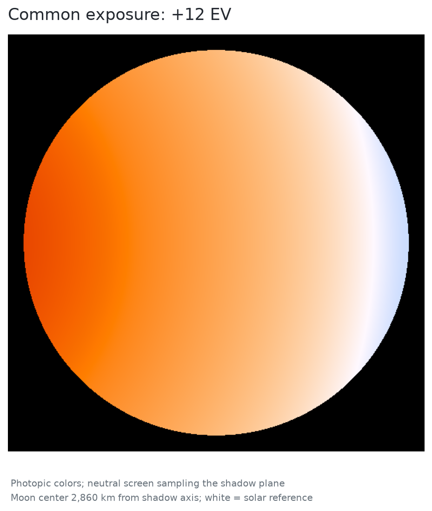
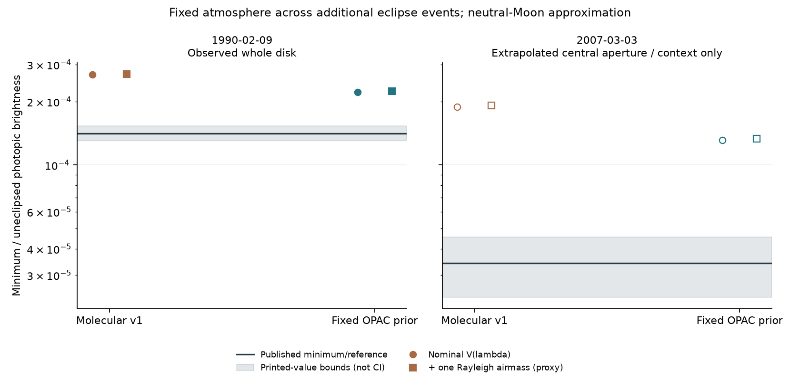
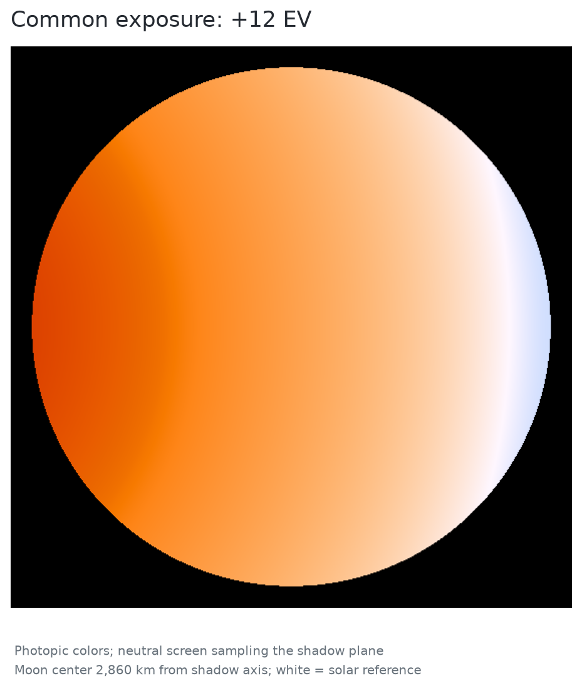
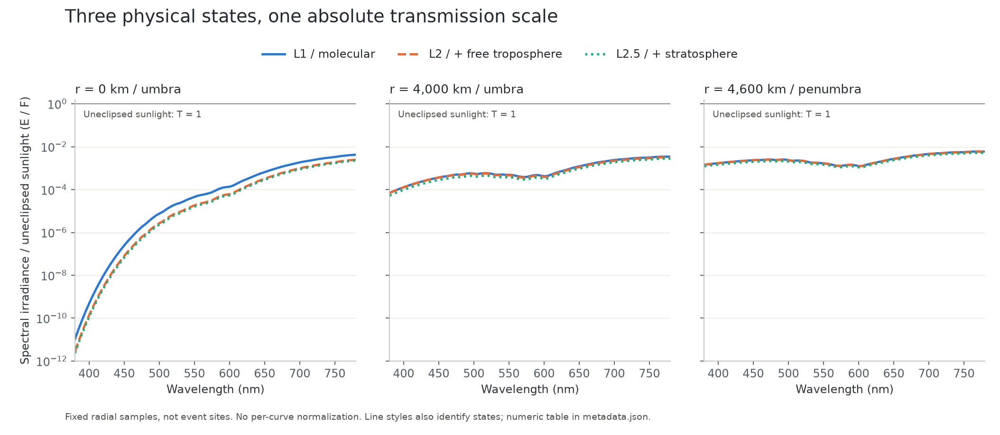
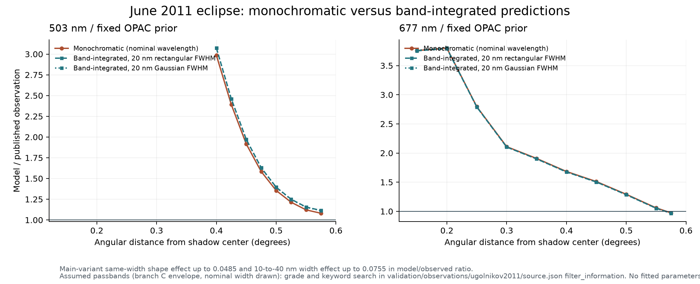
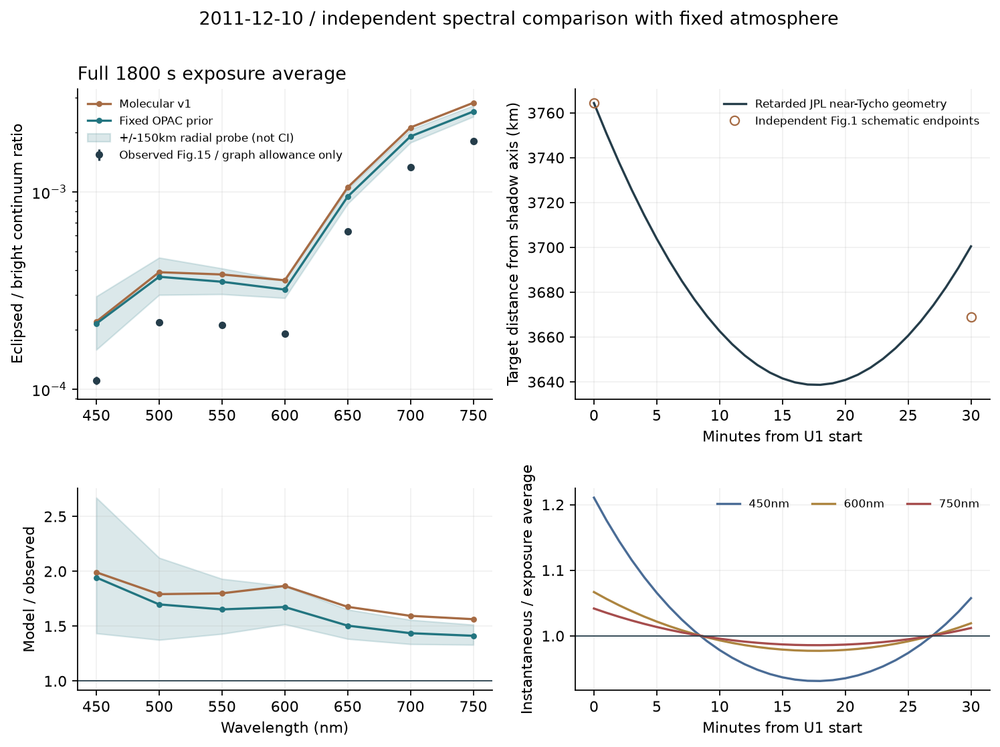
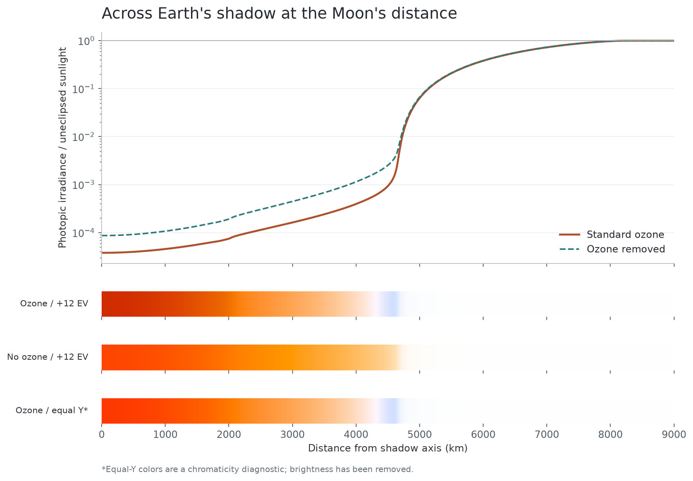

# 月食颜色主线：从算对光路到解释观测

> English translation: [MAINLINE.en.md](MAINLINE.en.md)（译本非权威，以本文件为准）

为什么地球挡住了太阳，月球却没有全黑？为什么月面偏红，影子边缘又可能偏冷？
本项目从太阳光谱出发，先算到达月球位置的光，再问它能否解释真实月食；不是从照片挑颜色，倒推一套大气。

## 分工与读者路线

本文拥有**阶梯抽象、方法论叙事、模块地图与未来写作的问题骨架**，不拥有第二份物理契约、参数表或执行台账。

| 要回答的问题 | 唯一权威入口 | 本文怎样使用 |
|---|---|---|
| 现在走到哪里，下一步何时值得做？ | [ROADMAP](ROADMAP.zh.md) | 解释推进逻辑，不复制里程碑状态表或排时间表 |
| 算的是什么，哪些近似必须保留？ | [MODEL](MODEL.md) | 解释各层解决的问题，不重定义公式和容差 |
| 气溶胶怎样组成，湿度作用在哪层？ | [AEROSOL](physics/AEROSOL.md) | 链接组件契约，不另抄参数或接口规则 |
| 数据来自哪里，校准值是什么身份？ | [SOURCES](../eclipse/data/SOURCES.md) | 保留先验与拟合的来源边界 |
| 数值究竟是多少？ | [committed 产物](../validation/results/README.md)及下文逐项字段 | **零数字手抄**：结论钉到生成字段，不再维护数值副本 |
| 代码怎样承载路线？ | [AGENTS](../AGENTS.md)与下文模块地图 | 对照实际职责，观察不等于本任务授权重构 |

阅读顺序：先看“计算对象”，再沿物理阶梯走；只想找代码可跳到模块地图，只想准备文章可看叙事钩子。
正文中的 L 标签是解释层级，不是 ROADMAP 的里程碑编号，也不是程序运行时开关。
事件名称、波段标识、单位、层级和命令不是新的结果账本。
历史文档中的“默认”按其当轮条件理解：早期 `fixed_opac` 是自由对流层单层，不可自动读成今天的双层默认；
双层复算的变体身份见[生产预测定义](../validation/results/stratosphere_background/predictions.json)。

新增的三态月盘、透射谱与剖面来自当前生产 CLI；三张月盘固定同一几何、尺寸和全局 +12 EV，
没有逐态提亮。这是中性月面屏，不是实拍或亮度拟合；显示高光压缩也使像素值不能直接当照度比。
读图约定见[图组说明](../figures/mainline/README.md)，唯一参数与来源账本见[图组 metadata](../figures/mainline/metadata.json)。
观测图仍引用历史单层快照，逐图标明代次；不能与新图混作同一状态的验证。

## 计算对象：先保留光谱，再谈月面颜色

主输出是月球距离、垂直日地轴平面上的**光谱照度**，不是望远镜收到的月面辐亮度。
球对称大气使它成为径向光场：太阳的有限圆盘提供一束束入射光，地球遮挡其中一部分，
折射把部分掠过大气的光弯入几何阴影，消光再决定每个波长还剩多少。
[MODEL 的计算量与输送契约](MODEL.md#quantity-being-computed)给出严格定义。

当前月球图片是一块中性月面屏对照明场的采样。光谱、光度量、共同曝光图和等亮色度诊断的证据身份不同；
把暗处提亮可以帮助看谱形，但不能把提亮后的图当作亮度预测。
这就是下面三条线必须分开的原因：**默认物理阶梯、校准/验证车道、渲染轴**。

## 阶梯：每一级增加什么，又留下什么

### L0 — 数值正确性：先问是否解对了声明的模型

- **新增物理**：不增加大气成分。这是所有梯级共享的验证地基，不是现实大气完整性的证书。
- **判别证据**：独立笛卡尔 ODE 核对弯曲光路与柱量；无大气极限核对遮挡几何；全接收平面的能量预算不依赖光落在哪里。
  [物理检查](../validation/results/physics.json)、[气溶胶路径检查](../validation/results/aerosol.json)、
  [分辨率检查](../validation/results/convergence.json)分别保存参数与结果；
  [独立测试](../tests/test_independent_physics.py)不是生产光路公式的同形副本。
- **可解释**：模型偏亮时，为什么不能立刻把误差归给大气？先排除光路、双侧柱量、落点分支与环带能量的实现错误。
- **边界**：ODE 仍共享所声明的分子介质。不同方程和积分器能核验输送，却不能证明这份介质就是某次月食的大气；网格收敛也不等于观测吻合。

### L1 — 分子大气：红色本影与冷色边缘的起点

- **新增物理**：相对不透明地球的几何遮挡，加入分子大气的折射、瑞利消光和臭氧吸收。
  光走完整双侧弯曲路径，再按有限太阳圆盘和守恒环带权重输送；色散、散入光等边界以 [MODEL](MODEL.md) 为准。
- **判别证据**：同一光路上关闭臭氧吸收的反事实，使分子基线的浅冷色边缘消失，见
  [MODEL 的机制与范围](MODEL.md#references-and-next-discriminating-experiments)及[基线图档](../figures/baseline)。
  但[首轮观测](records/OBSERVATIONAL_VALIDATION.md#首版分子模型结论)显示内部系统性偏亮。
- **可解释**：折射使几何本影仍有照明，长掠过路径上的短波消光使内部偏红；臭氧的选择性吸收能改变外缘谱形，不能只用“蓝光都被散射掉”解释所有位置。
- **边界**：计算的是未散射光。冷边机制不等于已验证观测中的绿松石带；其宽度、饱和度与绝对亮度仍需匹配波段和空间位置的观测。


**图 1 · 分子大气下的中性月面屏，当前生产 CLI，统一 +12 EV。**
**本章看点**：从靠影轴一侧的暖色到外侧浅冷色，图像展示同一径向照明场的空间采样。
它不是月面照片，冷色边缘的观测身份仍受上面的边界限制；请与图 2、图 4 按同曝光比较。

### L2 — 自由对流层气溶胶：让增量命中真正送光的高度

- **新增物理**：在既有气体光路上加入有独立出处的自由对流层消光，不改变气体折射几何，不加入散射进接收方向的光。
  组件和零值复原语义只在 [AEROSOL](physics/AEROSOL.md) 定义。
- **判别证据**：[第二轮](records/ROUND2.md)先用贡献高度、太阳临边昏暗与密度探针区分候选，再选文献先验。
  [当轮分析](../validation/results/round2/analysis.json)的 `selected_increment` 与
  `identification_scope`钉住选择及其证据等级；这里不复制当轮对照数值。
- **可解释**：为什么额外消光能优先压低深本影，而不能随便拿近地边界层预设代替？关键是哪些掠过路径仍向接收口径送光，而不是地面看起来霾有多重。
- **边界**：收益不构成唯一因果归因，也未关闭偏亮。[跨事件比较](records/MULTI_EVENT_OBSERVATIONS.md)扩大了考验：亮度可以改善，名义蓝/红形状却可能恶化；历史单层先验不是事件实测廓线。



**图 2 · 当前 CLI 的 FT 单层态，与图 1 同几何、同尺寸、同 +12 EV。**
**本章看点**：靠影轴一侧在增加消光后变暗；浅色高光受共同压缩，不能仅凭显示像素衡量收益。
这只是增量的可视化，不是某次真实月食的大气归因。



**图 3 · 历史 v0.2 分子/FT 单层比较，不是当前双层或湿度 A/B。**
1990 为整月面明视觉测光，2007 是中央视场的外推最低值、仅作背景；阴影为发表 ± 值的角点范围，**不是置信区间**。
**本章看点**：左图先验点相对分子点降低、但仍在实测参考之上；右图标题明确写着 `context only`，不能算第二个独立实测最低值。

### L2.5 — 平流层背景：补齐有证据的高层消光，不宣布亮度结案

- **新增物理**：把同源文献的平流层背景与自由对流层组成分层气溶胶柱，每层保留自己的路径光深和谱律。
  这不是把单层 AOD 调大，也不是把两层合成一个有效谱斜率。
- **判别证据**：[判别表](../validation/results/extinction_gap_diagnosis/discrimination.json)的
  `discrimination.json:candidates.stratosphere_background.events.*.brightness.verdict`显示各口径亮度仍在张力带。
  它改善 June/Dec 的所列形状指标，HST 的所列斜率却微恶化；逐项核对
  `discrimination.json:candidates.stratosphere_background.events.dec_2011.shape`与
  `discrimination.json:candidates.stratosphere_background.events.hst_2019.shape`，不能概括成“所有形状都改善”。
  [预注册核对](../validation/results/stratosphere_background/preregistered_check.json)的
  `preregistered_check.json:verdict`检验探针预测与生产实现是否一致。
- **可解释**：为什么较高层的消光可能比更多低层消光更好地修正蓝/红形状？它命中的是不同波长贡献核的不同高度质量。
- **边界**：[standing gap 的既有裁决](physics/AEROSOL.md#evidence-and-interpretation)仍有效：此组件没有闭合亮度残差。
  宽低层代理虽能压暗，却有形状代价和菜单选择效应，不能因“更暗”进入默认。



**图 4 · 当前生产双层背景，与图 1、图 2 共用 +12 EV。**
**本章看点**：仍能看到暖色内部与浅冷色外缘；与 FT 单层的可见差异有限，月盘本身不能裁定残差是否闭合。
这里没有拟合态，也不以图像替代上面各口径的亮度和形状字段。



**图 5 · 同一 CLI 网格上的三态透射谱，纵轴为无量纲 E/F，横轴为波长 nm。**
**本章看点**：影轴面板的谱形强烈向长波倾斜，外侧面板更平；同一面板内可分辨增加消光后的绝对幅度变化。
所有分面共用对数纵轴和食外 `T=1` 参考，未逐曲线峰值归一或等 Y。
三处半径只是显示采样；最右点按本次几何位于半影，不是本影内观测站点；数表可从图组 metadata 读回。

### 校准车道 — 先校对测量口径，再问闭合需要什么

- **新增物理**：本车道本身不增加生产默认物理。带通积分属于观测量匹配；跨事件反演与 `calibrated:` preset 属拟合与显式展示。
  湿度增长有来源、已可选作用于 FT 组件，但逐事件求根仍是校准，不因参数有物理名字而变成独立预测。
- **判别证据**：
  - **口径先行**：[滤镜增补](records/OBSERVATIONAL_VALIDATION.md#滤镜带通口径2026-11-增补)使用假设带型包络，而非实测响应。
    [带通产物](../validation/results/filter_response_2011/analysis.json)的 `analysis.json` 在仓库内同名不唯一，故此处只给显式文件链接，不写歧义字段引用。
    深处残差不能由所测带通效应解释，最外点只是边际改变；方向必须区分固定先验与分子变体。

    

    **图 6 · June 历史 FT 单层主变体的带通口径探针，不是当前双层或实测滤镜响应。**
    图中带型是**假设响应包络**；观测为图表读数，读取裕量不是测量误差，分子等其他变体须查原产物。
    **本章看点**：主变体的单色/带通曲线彼此接近，深处仍远离 `model / observation = 1`；不能把滤镜未知性当作已经解决。

  - **所需大气**：[跨事件反演](../validation/results/atmosphere_inversion/inversion.json)在双层基线上对固定增量形态求根。
    `inversion.json:preregistered`拥有拟合/留出划分与准则；`inversion.json:cross_event.verdict`保留跨事件张力，
    `inversion.json:cross_event.prediction_matrix`检查把某事件的增量用于别的事件会怎样。
    [注册表](../eclipse/data/calibrated_presets.json)把结果标成 `calibrated_not_physical_prior`，不替换默认。

    

    **图 7 · Dec2011 历史分子/FT 单层固定模型，名义 Tycho 位置的整段曝光平均。**
    观测点来自图表连续谱读数；读取裕量不冒充测量误差，径向位置探针也不是置信区间。
    **本章看点**：右上轨迹和右下“瞬时/曝光平均”说明为什么不能拿单个时刻代替整段曝光；
    左下保留固定模型相对读数的残差。它不是当前双层、湿度 A/B 或反演后拟合图。

  - **湿度 A/B**：[来源普查](records/PRIOR_SOURCE_SURVEY.md)恢复的组件数据经[湿度先验转录](../validation/results/prior_source_survey/humidity_axis_priors.json)进入 FT 标量增长轴。
    `humidity_axis_priors.json:q_rest_derivation`记录非增长余项的减法约束，
    `humidity_axis_priors.json:layer_scope_rulings`限定平流层与校准增量不随这根轴湿度化。
    [A/B 产物](../validation/results/humidity_axis/inversion_ab.json)的 `inversion_ab.json:b50_reproduction_gate.verdict`先钉参考档位精确复现原反演。
    A 只求 RH：`inversion_ab.json:humidity_sufficiency.model_verdict.per_event.*.verdict`显示各事件的拟合子集均能在规定域内闭合；
    B 固定湿度档位，再求剩余增量：`inversion_ab.json:variant_b.ladder`、`inversion_ab.json:r_rh`及
    `inversion_ab.json:share_table`共同保留状态、参与事件与份额。
- **可解释**：固定先验留下的亮度缺口，能否由一个受来源约束的方向在模型内吸收？A 给逐事件闭合需求，B 给同档湿度下还剩多少增量。
  中湿档的跨事件散布仍判张力；高湿档全部 `over_closed`，散布判定为 `degenerate`，不是“无需增量所以通用模型通过”。
- **边界**：份额测量不是因果归因，RH 求根不是真实事件湿度观测。
  `inversion_ab.json:humidity_sufficiency.preregistered_proxy`是已被机器结果证伪的线性 AOD 预算代理，仅留作审计；
  `inversion_ab.json:humidity_sufficiency.model_verdict`才承载模型内充分性。
  A 的留出与形状账户仍须查 `inversion_ab.json:variant_a.june_2011.shape`、`inversion_ab.json:variant_a.dec_2011.shape`及
  `inversion_ab.json:variant_a.hst_2019.shape`，不能只看拟合闭合。
  [敏感性附表](../validation/results/humidity_axis/inversion_ab.json)的 `inversion_ab.json:sensitivity_appendix`保留插值选择、标量轴的谱形遗漏与独立气象核验缺口；不由本文改判 standing gap。

### L3+ — 事件相关廓线、云、三维结构与散射：尚未实现的方向

- **新增物理**：本节没有已实现的新增组件，也不把这些方向合成一个承诺中的“大模型”。
- **判别证据**：[ROADMAP 的进入条件](ROADMAP.zh.md#后续方向与进入条件)拥有每个方向所要回答的缺口：
  位置/吸收形状残差推动实际气体廓线检查，方向不对称推动三维天气约束，透射很弱时再判别散入光，后续是否需要多次散射另验。
- **可解释**：下一轮应由哪类残差和可得观测选择，而不是按名词的复杂度升级？事件相关大气、光源结构和观测口径是可分辨的候选，不是互相代偿的旋钮。
- **边界**：没有时刻与位置对应的独立资料，给每场月食更多参数只能扩大拟合空间；新增散入光也不能单独解决现有偏亮。进入条件不等于实施时间表。

### 渲染轴 — 月面屏、BRDF、观察者与显示：与验证车道正交

- **新增物理**：当前只有中性屏与色度/显示变换；真实月壤反射、BRDF 和观察者条件仍是方向，不是本次实现。
- **判别证据**：[MODEL 的显示契约](MODEL.md#color-and-display)区分共同曝光与等亮诊断，
  [ROADMAP 的月面与视觉方向](ROADMAP.zh.md#后续方向与进入条件)及[贴图方向](ROADMAP.zh.md#月面贴图的实现方向)区分真实反射与展示近似。
- **可解释**：同一个照明光谱为什么可能生成不同外观？月面区域权重、反射方向、相机或观察者、曝光与显示都会介入。
- **边界**：贴图、白点或曝光改变不构成新大气证据；校准 preset 的漂亮图片仍是校准图片。照明场必须能脱离图像单独读回。



**图 8 · 当前双层态的径向明视觉照度与生产色条；横轴为影轴距 km，纵轴为食外太阳 Y 比。**
**本章看点**：从暗本影向半影照度快速上升；臭氧 on/off 的共同 +12 EV 色条帮助定位冷色谱形的变化。
`ozone-off` 只改变吸收，折射与其他介质不变；最后的 **equal-Y 色条已逐半径移除亮度，只是色度诊断，不是亮度预测**。
不能拿等 Y 色条的鲜艳程度代替上方光度曲线。

## 方法论：推动阶梯的不是画面，而是判别力

### 探针先于物理：先确认候选碰不碰得到缺口

原则：不先建设一个完整组件再找理由保留，而先用同口径反事实检查它能改变什么。
实例：[缺口判别](records/OBSERVATIONAL_VALIDATION.md#判别探针与相容性排序)里，常见浅边界层类型在事件级亮度上均为排除倾向，
但这不表示最深单点完全不受影响。对照
`discrimination.json:candidates.continental_clean.events.*.brightness.verdict`与
`discrimination.json:candidates.continental_clean.events.june_2011.brightness.max_readout_gap_closure_fraction`。
证伪的是“这些浅层先验足以解释各口径主要缺口”，不是“地球没有边界层”。

### 预注册：生产实现不许追着预期结果调参

原则：先钉预测对象、准则与容差，再让另一条执行路径接受核对。
实例：平流层探针进入默认前，判别表的值已是预测；生产分层实现核对结果见
`preregistered_check.json:rows`，实测差异见 `preregistered_check.json:measured_max_absolute_diff`，
容差规则另在 `preregistered_check.json:tolerance_definition`，不由实测差异反推。
这种一致性核验支持“增量实现符合预测”，不是两份完全独立的物理证据：探针与生产仍共享部分介质和光路机器。

### 三种证据身份：独立先验、同事件校准、独立预测

原则：参数来自哪里与结果在哪检验，是两件事。
实例：OPAC 背景先验来自独立来源；[第二轮红波段校准与蓝波段留出](records/ROUND2.md#效果与仍然存在的残差)仍属同事件检查；
[多事件固定模型对照](records/MULTI_EVENT_OBSERVATIONS.md)才提供不同事件的考验。
[先验普查的覆盖矩阵](../validation/results/prior_source_survey/coverage_matrix.json)只说明来源覆盖哪些维度，不授权选某个新默认值。
湿度增长的来源独立，也不使拟合得到的逐事件 RH 自动独立。

### 两轴机制：贡献核高度分布 × 成分作用带

原则：不能仅凭粒子的谱斜率猜接收端颜色变化；应先问不同波长的光从哪些路径来。
实例：[机制分析](records/OBSERVATIONAL_VALIDATION.md#机制发现形状响应由高度选择性决定)中，Dec 的蓝与红贡献核在低层的质量不同。
[高度产物](../validation/results/extinction_gap_diagnosis/height_stats.json)的 `height_stats.json:kernel_identity`定义核与高度带语义，
`height_stats.json:summary.worst_relative_gap`核对零阶矩与原预测；核的高度分布不是实测大气廓线。
低层增量优先削弱所命中的红核，高层增量命中更多蓝核，能带来相反的蓝/红变化。
湿度机器的 `inversion_ab.json:humidity_sufficiency.effectiveness`进一步说明：相同垂直 AOD 的跨层增量并非等效，线性预算不能裁定非线性传输闭合。

### 跨事件终审：同向证据不是所有指标同向改善

原则：候选必须带着未解决的残差跨出口径，不能以某一条拟合曲线结案。
实例：June 局部曲线、HST 星载谱、Dec 曝光平均谱、1990 整月面测光在
[相关表](../validation/results/extinction_gap_diagnosis/correlation.json)的
`correlation.json:event_level.*.fixed_opac.residual_ln_ratio_median`保留共同偏亮方向；
`correlation.json:cross_event`报告深度排序，样本规模不足以支持强因果声明。
“同向”指这项亮度残差/改进证据，不是各事件的所有形状和留出指标全通过。
四种口径也不是能随意拼成一个颜色误差分数的同质样本。

## 模块地图：阶梯不等于目录顺序，车道不等于显示风格

### 生产链与数据消费边界

下表按 [AGENTS](../AGENTS.md) 的职责次序读，不宣称只能相邻调用。
例如 `rays` 同时消费介质与光谱，`cli` 跨层编排；`color` 直接读取 `spectra` 的色匹配函数。

| 模块 / 来源 | 职责 | 梯级 / 车道 | 为什么在这个位置 |
|---|---|---|---|
| [spectra.py](../eclipse/spectra.py) | 太阳谱、CIE、臭氧截面表与分子光学公式 | L1 基础输入；色度共享 | 波长相关数据不应决定高度廓线、接收几何或曝光 |
| [atmosphere.py](../eclipse/atmosphere.py) | 分子密度与梯度、独立归一化的臭氧高度分布 | L1 介质 | 定义高度结构，不承载气溶胶湿度或逐事件反演 |
| [aerosol.py](../eclipse/aerosol.py) | 有限层消光、逐层谱律、柱组合与 FT 湿度增长 | L2/L2.5；可选湿度物理 | 可移除的消光组件不应修改气体折射，也不执行观测拟合 |
| [rays.py](../eclipse/rays.py) | 双侧弯曲路径、气体柱和逐层气溶胶光深表 | L1–L2.5；L0 被核验对象 | 从介质生成不依赖接收半径的前向表，尚不做月面采样 |
| [transport.py](../eclipse/transport.py) | 有限太阳、落点全分支、守恒接收积分及光谱求解 | L1–L2.5 输送 | 在物理量层组合路径与接收几何，不施加显示裁剪 |
| [color.py](../eclipse/color.py) | 光谱到物理 XYZ/Y，以及色适应、RGB 和显示变换 | 光度接口 × 渲染轴 | 同文件跨光度/显示接口，不能把其中所有输出都当显示量或都当光度量 |
| [report.py](../eclipse/report.py) | 输入核验、相对 Y 诊断、剖面/月盘图与报告 JSON | 科学报告 × 渲染轴 | 从已有光谱派生诊断与报告，不追迹或反演；并非仅做显示 |
| [cli.py](../eclipse/cli.py) | 参数校验、介质/几何构造、求解编排与原始产品写出 | 默认 / 显式校准 / 渲染入口 | 应用层选择车道并保存 provenance，而不是把拟合偷偷放进介质默认 |
| [calibrated_presets.json](../eclipse/data/calibrated_presets.json) | 按事件命名的完整校准大气消费注册表 | 校准数据层 | CLI 显式选择才读取；事件映射以 registry 的 `event` 为准，反演机器不搬进生产包 |

包级 [__main__.py](../eclipse/__main__.py)转交 CLI，[__init__.py](../eclipse/__init__.py)承载包信息；不是额外物理层。
注册表携带反演产品的来源哈希，实际值/形态/划分由[注册表锚定测试](../tests/test_atmosphere_inversion.py)核验；
运行时加载不等于重新求反演或实时核算来源文件哈希。这里核对的是源码树消费路径，不宣称已经验收分发包。

### 验证机器：独立数值核对、观测聚合与研究账本

| 入口 / 来源 | 职责 | 梯级 / 车道 | 为什么留在 validation |
|---|---|---|---|
| [check_physics](../validation/check_physics.py) | Cartesian ODE、几何/落点折叠与全平面通量闭合 | L0 | 独立参考方程用于核验生产输送，不是另一套生产路径 |
| [check_aerosol](../validation/check_aerosol.py) | Bessel 直线参照、曲线路径独立 ODE、分层通量检查 | L0 × L2/L2.5 | 组件路径正确性需要不同数值链路，不应由展示图自证 |
| [check_convergence](../validation/check_convergence.py) | 高度与光谱分辨率分开细化，光度和色度误差分开 | L0 × 渲染诊断 | 数值精度是声明模型的验证，不是新增物理 |
| [compare_observations](../validation/compare_observations.py) | June 分子基线、几何/臭氧/网格探针与观测读取 | L1 固定比较 | 具体图表口径和历史条件不应进入默认求解器 |
| [round2_analysis](../validation/round2_analysis.py) | FT 增量判别、临边昏暗/密度探针、红波段校准与蓝留出 | L2 证据；同事件校准 | 同脚本有固定先验与拟合两类账户，不能统称独立预测 |
| [filter_response_2011](../validation/filter_response_2011.py) | 带通核、假设响应包络及单色列复现 | 观测口径 | 改的是可比量而非大气，滤镜未知性需独立保留 |
| [compare_dec2011](../validation/compare_dec2011.py) | 线性光谱的完整曝光平均、几何与位置敏感性 | 固定比较 | 曝光聚合是观测算子，不能用平均颜色替代 |
| [compare_hst2019](../validation/compare_hst2019.py) | 原始 STIS FITS 提取、全月参考和曝光加权比较 | 星载固定比较 | 接收者、仪器、采样漂移属于这组资料的可比性 |
| [multiple_events](../validation/multiple_events.py) | 偏置圆孔/月盘平均与视觉光度 | 固定比较 | 整月面与局部读数不是同一口径；外推背景与实测须分开 |
| [extinction_gap_diagnosis](../validation/extinction_gap_diagnosis.py) | 四口径贡献核、高度统计、相关与文献候选探针；生产双层复算 | L2→L2.5 判别 | 依赖观测聚合与已提交基线；是当前高度诊断单源，不是另起 transport |
| [atmosphere_inversion](../validation/atmosphere_inversion.py) | 双层基线上的逐事件增量求根、留出、形状、预测矩阵 | 校准车道 | 目标与划分依赖观测，不能成为默认介质工厂 |
| [humidity_axis_inversion](../validation/humidity_axis_inversion.py) | A 的 RH 求根、B 的湿度阶梯残余增量及份额账本 | 湿度校准研究 | 调用生产湿度组件和既有反演机，研究设计不反向定义默认物理 |

helper 按语义复用而非按长度迁移：当前贡献核在 `extinction_gap_diagnosis`，
曝光平均在 `compare_dec2011`，波段聚合在 `compare_hst2019`，圆孔与光度权重在 `multiple_events`。
`round2_analysis` 的高度分位数保留为历史生成器与锚点，不继续扩成第二个通用高度诊断。
湿度反演复用 `atmosphere_inversion`，而不是再写一套近似同名目标函数。

### 数据取得与转录：不是生产或校准求解

| tools 入口 / 来源 | 职责与对应车道 | 为什么在 tools |
|---|---|---|
| [extract_ugolnikov2011.py](../tools/extract_ugolnikov2011.py) | 固定 PDF 矢量曲线转录及滤镜信息分支核查；June 观测输入 | 获取/转录有自己的来源合同，不由传播求解时联网完成 |
| [fetch_eclipse2011_geometry.py](../tools/fetch_eclipse2011_geometry.py) | June 的 Horizons 日月距离 | 外部几何资料是固定比较输入，不从亮度反演位置 |
| [extract_yan2011.py](../tools/extract_yan2011.py) | 固定栅格图连续谱读数及可选图示 QA | 提取误差与测量误差必须在来源侧分开 |
| [fetch_dec2011_geometry.py](../tools/fetch_dec2011_geometry.py) | 月面站点曝光轨迹、光时和图示核对 | 几何重建不该夹在生产大气组件中 |
| [extract_hernitschek2008.py](../tools/extract_hernitschek2008.py) | 下载/读 HTML 并核对已转录测光表，不重新生成表 | 名字叫 extract，实际仍须按源代码区分转录器和复核器 |
| [fetch_photometry_geometry.py](../tools/fetch_photometry_geometry.py) | 发表测光事件的近似时刻星历距离 | 未公布最低值时刻的近似属于观测输入条件 |
| [fetch_hst2019.py](../tools/fetch_hst2019.py) | MAST FITS/论文缓存、header 与哈希来源合同 | 原始产品取得不等于已经完成光谱比较 |
| [fetch_hst2019_geometry.py](../tools/fetch_hst2019_geometry.py) | HST 成员曝光、月面指向和独立影轴重建 | 采集层复用 December 的影轴坐标函数，不另抄几何公式 |

先验普查的来源、增长表与覆盖矩阵是[已提交调查产物](records/PRIOR_SOURCE_SURVEY.md#where-the-evidence-lives)，
不假造一个并不存在的 `validation.prior_source_survey` 自动再生成入口。

## 叙事钩子：给未来文章的问题，不提前写结论

| 问题 | 目前能答到哪一级 | 能答与不能答的边界 / 回看证据 |
|---|---|---|
| 地球挡住太阳，月球为什么仍亮、还偏红？ | L1 | 折射与分子消光给机制；绝对亮度还需气溶胶及跨事件考验，见 [MODEL](MODEL.md) |
| 绿松石带到底是什么，是模型已经验证的那圈蓝吗？ | L1 机制；观测验证仍开放 | 冷色边缘不等于带宽/饱和度复现，见 [ROADMAP](ROADMAP.zh.md#绿松石带需要的证据) |
| 影子边缘为什么反而可能出现冷色？ | L1 | 同路径臭氧吸收反事实支持谱形机制，不代表完整真实月面外观，见 [MODEL](MODEL.md#references-and-next-discriminating-experiments) |
| 光路都算对了，为什么模型还是偏亮？ | L0→L2.5 | 数值核验与现实大气是两道问题；固定先验 standing gap 未关，见 [AEROSOL](physics/AEROSOL.md#evidence-and-interpretation) |
| 多放一点近地霾，为什么未必有用？ | L2→L2.5 判别 | 接收核对浅层的可达性而非地面 AOD 决定效应，见[判别表](../validation/results/extinction_gap_diagnosis/discrimination.json) |
| 为什么更暗了，蓝/红谱形却更错？ | L2/L2.5 两轴机制 | 作用高度与各波长贡献核共同决定，见[机制分析](records/OBSERVATIONAL_VALIDATION.md#机制发现形状响应由高度选择性决定) |
| 调到吻合的月食图，为什么不算独立预测？ | 校准车道 | 拟合子集、同事件留出、新事件三者证据不同，见[反演](../validation/results/atmosphere_inversion/inversion.json)与 [SOURCES](../eclipse/data/SOURCES.md#calibration-lane-preset-registry) |
| 湿度能解释多少，求出的 RH 就是真实天气吗？ | 湿度 A/B | 能回答模型内闭合需求与残余份额，不能替代独立气象证据，见[A/B](../validation/results/humidity_axis/inversion_ab.json) |
| 加月海贴图或换曝光，能不能把偏差修好？ | 渲染轴 | 能改变外观和月面权重，不能回头改变照明场的物理证据，见 [ROADMAP](ROADMAP.zh.md#月面贴图的实现方向) |

清单是可编辑的写作地基，不是文章成稿，也不是“所有问题已解决”的完备性声明。

## 架构反馈：现行结构怎样承载这条梯子

就当前核对的职责与调用边界，**未发现需要靠改写 covenant 才能解释的分层偏离**：
生产包不导入 `validation` / `tools` 的实现；观测驱动的探针与反演留在验证侧，
可选湿度进入气溶胶工厂，校准值经显式数据注册表消费，而不是渗入默认。
这不是用“零偏离”盖过细节：以下观察点必须与该判定一起读。

- **职责链不是严格相邻调用链**：`cli` 跨层编排是应用入口职责，`report` 派生科学诊断也不是越权求解。
  因此不能为了表面整齐把科学 Y 全部视作显示，也不能把观测 helper 都下沉 `eclipse/`。
- **反事实按作用层级数，不按布尔个数误判**：[transmission_profile](../eclipse/transport.py)有 `ozone`、`aerosol` 成分开关和 `extinction` 总旁路。
  总旁路保留折射表，并不变成真空直线传播；臭氧反事实在同一表上只改吸收。
  这不是已加入第三个独立成分的证据；若以后增加成分反事实，何时审查 attenuation stack 只按 [AGENTS](../AGENTS.md) 的既有规则执行，不在此新设门槛。
- **可移除性是真实机制**：气溶胶工厂/光线表保留零值复原，`aerosol=False`保留同表对照，
  湿度参考状态精确恢复原状态；其约束见 [AEROSOL](physics/AEROSOL.md)与[反事实测试](../tests/test_aerosol_transport.py)。
  分层光深必须与各层自己的谱因子成对消费，不能从叙事的“加一层”推成合并谱律。
- **科学数据与报告存在编排边界**：[CLI](../eclipse/cli.py)负责原始 NPZ/CSV/元数据，`report`写派生诊断与图。
  `--no-plots`目前跳过整个报告函数，因而不生成该函数的报告 JSON；它不是只隐藏图片的同义词。
- **复现接口有真实例外**：[HST 写出](../validation/compare_hst2019.py)会在 `--out`之外重写观测侧 `spectra.csv`，
  且需要未随仓库提交的原始 FITS 缓存。这不是主包分层偏离，但确实影响复现的隔离边界，不能把它包装成普通只写 outputs 的命令。

这些是当前结构的解释与观察，不是本任务附带的重构清单；新物理的进入仍由残差与独立证据决定。

## 复现：读回证据与重跑求解分开

从仓库根目录运行，先 `uv sync --locked`。下列重跑目标均使用 ignored `outputs/`，
示例根目录 `outputs/mainline-rerun/`应换成尚未使用的目录，避免覆盖自己的旧实验。
文件型 `--out`与目录型 `--out`不可混用；所有命令均不以 `validation/results/`或 `figures/`作为再生成目标。

### 主线自身的轻量验收与图组复现

新增图组的一键离线入口只编排当前生产 CLI，不重画历史观测快照。
环境已按锁文件备妥时，使用 `--offline --no-sync` 避免依赖同步触网；输出根须尚未使用。

```bash
uv run --offline --no-sync python tools/render_mainline.py --out outputs/mainline-check-a
uv run --offline --no-sync python tools/render_mainline.py --out outputs/mainline-check-b
diff -qr outputs/mainline-check-a outputs/mainline-check-b
uv run pytest -q tests/test_mainline_docs.py tests/test_mainline_figures.py
uv run pytest -q tests/test_extinction_gap_diagnosis.py -k docs
uv run pytest -q
```

字段闸与既有文档共用[单源解析器](../tests/docs_references.py)：反引号中的 basename JSON 字段引用须唯一定位、每个通配分支可读；
同名 `analysis.json`/`comparison.json`用显式文件链接，不静默取第一个文件。
本地 Markdown 链接/图片检查以文档目录定位，剥离 query/fragment 并解码路径；外链不联网，页内锚点不当作文件。
[临时夹具负例](../tests/test_mainline_docs.py)证明坏字段、坏文件和歧义会失败。
[图组读回闸](../tests/test_mainline_figures.py)另检查实际图片集合、逐图 hash、PNG 元数据剥离及三态模型/显示 provenance；
双跑的六个生成文件应全部逐字节相等，并逐项与 committed 图组比较（README 是手写说明，不在生成集合）。
字节契约限同源码、输入、锁定依赖与受支持运行环境；JSON 无时间/耗时、绝对输出路径，PNG 不含附加元数据。
全量渲染是按需验收，不加入 pytest；数值表与 provenance 只在图组 metadata，不另抄参数账本。
这些闸只证明地址和约定可读，不证明解释正确、锚点存在或数字能承载因果归因；本文避免用数组位置表达事件结论。

### 数值地基与生产输出

```bash
uv run python -m validation.check_physics --out outputs/mainline-rerun/numerics/physics.json
uv run python -m validation.check_aerosol --out outputs/mainline-rerun/numerics/aerosol.json
uv run python -m validation.check_convergence --out outputs/mainline-rerun/numerics/convergence.json
uv run lunar-eclipse simulate --out outputs/mainline-rerun/default
uv run lunar-eclipse simulate --aerosol none --out outputs/mainline-rerun/molecular
uv run lunar-eclipse simulate --aerosol opac-ft --out outputs/mainline-rerun/ft-only
```

历史快照按各自保存的介质解释，不能把当前默认检查与历史分子/单层快照直接作无条件差分；
`check_convergence`的 `--aerosol`可显式选择历史介质。

### 观测、判别与校准机器

```bash
uv run python -m validation.compare_observations --out outputs/mainline-rerun/june-molecular
uv run python -m validation.round2_analysis --out outputs/mainline-rerun/round2
uv run python -m validation.filter_response_2011 --out outputs/mainline-rerun/bandpass
uv run python -m validation.compare_dec2011 --out outputs/mainline-rerun/dec2011
uv run python -m validation.multiple_events --out outputs/mainline-rerun/multiple-events
uv run python -m validation.extinction_gap_diagnosis --out outputs/mainline-rerun/extinction-gap
uv run python -m validation.extinction_gap_diagnosis --strat-rerun --out outputs/mainline-rerun/stratosphere
uv run python -m validation.atmosphere_inversion --out outputs/mainline-rerun/inversion
uv run python -m validation.humidity_axis_inversion --out outputs/mainline-rerun/humidity
```

这些入口默认读取仓库内的已提交观测、几何和比较产品：`--out`只改变写出位置，
不会把刚刚生成的另一目录自动接成下游输入。诊断先校验既有文献参数；平流层复算另读取已提交判别表；
反演依赖已提交双层预测；湿度 A/B 再读取已提交原反演池和湿度先验。
因此从 committed HST 比较产品复算诊断/反演，不等于从原始 FITS 重新提取。

**HST 原始提取是隔离例外，不放入上面的日常重跑序列。**
其真实入口是 `uv run python -m validation.compare_hst2019 --out outputs/mainline-rerun/hst2019`，
但只有在**可丢弃的完整源码副本**、按[观测来源合同](../validation/observations/hst2019/README.md)备妥并核验原始 FITS 缓存之后才运行。
现有入口没有关闭观测侧 `spectra.csv`写出的参数；不要在需要保持 committed 输入不变的工作树里以为传 `--out`就隔离了全部写入。

### 来源与采集不是一键复算

上方 tools 表给出实际脚本入口；联网恢复和 PDF 转录按各观测来源说明另行进行，不能无条件复制默认命令：
多数工具默认写观测目录，PDF 工具还需额外依赖；测光表复核器没有通用 `--out`。
HST 下载工具把 `--out`所指文件当已有哈希合同来源，改到新文件不代表自动继承旧合同。
本次插图只现算生产三态说明图；没有下载新资料、重建观测、重跑观测对照或刷新历史快照。
历史观测证据仍按其原模型代次解释，新图不能充当新增观测验证。
