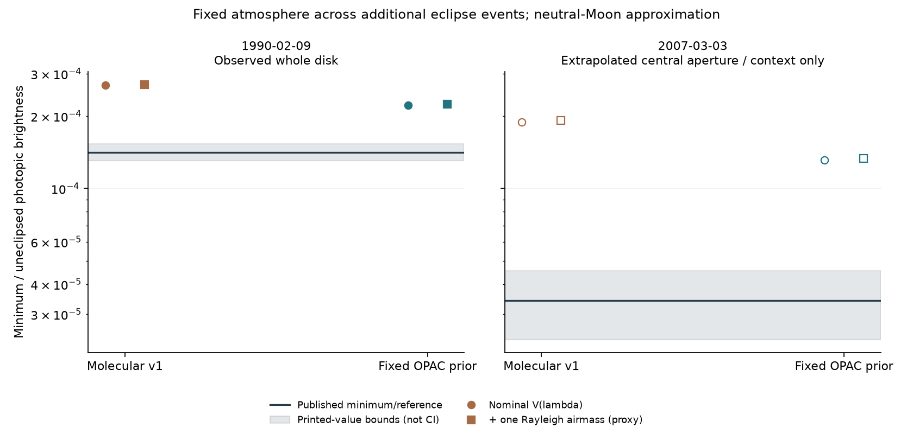

# 多次月食的公开观测参照

本轮扩大观测范围，保持 v0.2 物理模型和默认气溶胶参数不变，不继续拟合 2011 年 6 月。
月食之间的大气环境不同；通用背景廓线的作用应由多个事件共同判断，单次事件的剩余偏差
不能全部归因于某一项缺失物理，也不能全部归因于天气。

本轮取得了一个可立即计算的新增实测亮度参照、一组新增光谱读数，以及后续可用资料的明确使用条件。
这还不是多事件完整颜色验证。各事件的空间、波段和归一化口径不同，不合并成一个误差分数。

## 已整理的资料与可用程度

| 月食事件 | 来源和观测量 | 本轮产出与边界 |
|---|---|---|
| 2011-06-15 | [Ugolnikov et al. Fig. 2](https://arxiv.org/pdf/1106.6178v2)：西侧本影 503/677 nm 的局部月面亮度比 | 原有参照；保留历史读数与结果，滤镜响应和逐点测量误差仍缺失 |
| **1990-02-09** | [Hernitschek et al. Tables 1–2](https://opg.optica.org/ao/abstract.cfm?uri=ao-47-34-h62)：整月面明视觉亮度 | **新增独立实测事件**；录入发表数值表，完成固定模型、中性月面近似的比较 |
| 2007-03-03 | 同一论文：中央 20 角分直径视场的明视觉亮度 | 已录入数值；云遮挡期间的最低值借用 1990 年光变形状外推，食外基线也有额外气溶胶警告。**只作背景，不能算第二个独立实测最低值** |
| **2011-12-10** | [Yan et al. Fig. 15](https://arxiv.org/pdf/1405.4780v1)：Tycho 附近同月面区域的食中／食外光谱比 | **新增 450–750 nm 的七个黑色实测曲线读数**；已核验曝光归一化。恢复半小时曝光中的采样轨迹后才进入模型比较 |
| 2019-01-21 / GF-4 | [Shu et al. 2024](https://doi.org/10.3390/rs16224181)：可见多波段月面辐亮度、全月面辐照度和蓝带分布 | 已核查官方 PDF 并保存来源合同；原始数据仅按需提供，全食期间无有效采样；发表图的比值含月面光度模型分母，尚不能直接当作本模型的透射率 |
| 2019-01-21 / HST | [Youngblood et al. 2020](https://arxiv.org/html/2008.01837)：公开 MAST/STIS FITS | 先前已确认归档下载；仍需实际指向、漂移和月面反射处理。主要覆盖蓝端，不能独立验证完整可见颜色 |

数据、来源版本及提取方法分别位于
[1990/2007](../validation/observations/hernitschek2008/README.md)、
[2011-12](../validation/observations/yan2011dec/README.md)、
[GF-4 来源合同](../validation/observations/gf4_2019/source.json)。
图表读数是可追溯的公开观测摘要，不是原始曝光；读取裕量始终与测量误差分开。

## 1990 年：新增独立亮度比较

发表数值为食外 `4450 ± 150 cd/m²`、最低 `0.63 ± 0.03 cd/m²`。
使用原数值相除得到最低／食外 **1.416 × 10⁻⁴**，不使用论文四舍五入后的动态范围的倒数。
源文把亮度修正到地面**一个气团量**，并非大气外。

比较采用表中的地心月球中心影轴角距 23.63 角分，以及食甚 19:11:05 UTC 的
[JPL Horizons](https://ssd-api.jpl.nasa.gov/doc/horizons.html) 距离：
地月 384865.542 km、日地 0.986709527 AU。食甚只是未发表准确测光最低时刻的近似；
不把论文经验放大的本影半径用来修改模型地球半径。

在月球物理圆盘上积分模型光谱，而非只取月球中心：

\[
\bar T_\lambda = \int \frac{2r}{R^2}f(c,r,R)T_\lambda(r)\,dr,
\qquad Q = \frac{\int F_\lambda V(\lambda)\bar T_\lambda\,d\lambda}
{\int F_\lambda V(\lambda)\,d\lambda}.
\]

其中 `f` 是以影心为圆心的圆环落在月面／测光视场内的方位角比例，`c` 是月心影轴距离。
使用 380–780 nm 太阳光谱与 CIE y；分子模型和固定 OPAC 先验共用几何，均未拟合比例、位移或大气参数。

| 1990 年整月面最低／食外 | 预测 | 预测／实测 |
|---|---:|---:|
| 实测 | 1.416 × 10⁻⁴ | 1 |
| 首版分子模型，名义 V(λ) | 2.683 × 10⁻⁴ | 1.90 |
| 固定 OPAC 默认值，名义 V(λ) | 2.222 × 10⁻⁴ | **1.57** |
| 固定 OPAC，加一个瑞利气团量响应探针 | 2.238 × 10⁻⁴ | 1.58 |



一个瑞利气团量的探针仅改变太阳与视觉响应的权重，不等同于原仪器及观测站完整校正。
它在此处影响很小，不能据此排除所有观测口径问题。模型仍将月球当作均匀中性屏，
真实月面反照率、光谱和相位／反向散射响应可能改变整月面加权结果；尚无足够信息建立完整误差预算。
图中阴影是将发表 ± 值取上下角点后得到的比值范围，**不是置信区间，也不是模型验收容差**。

新增事件支持一个有限结论：独立背景气溶胶先验在另一场月食上也降低了偏亮，
但当前预测仍偏亮约 57%。这既不能称为高精度吻合，也不能直接反推出真实气溶胶 AOD。
2007 年按中央视场计算的默认预测约为外推最低值的 3.84 倍，只保留作背景，不参与跨事件实测结论。

积分核通过均匀圆盘的面积及二阶矩独立解析检查；另一条以视场中心为原点的二维积分
核对了非恒定函数与四阶矩，误差约 4 × 10⁻¹⁵。128 点／5 nm 到 256 点／2.5 nm 的实际预测变化
最大约 0.21%，详情保存于 [analysis.json](../validation/results/multiple_events/analysis.json)；
这些数值检查不覆盖上述观测近似。

## 2011 年 12 月：保留新光谱，先补几何

Fig. 15 已包含曝光时长修正 `(U1/B2)/300`，不能再次除以 300，也不能使用刻度不同的 Fig. 3 代替。
本轮从固定版本 PDF 内嵌位图提取黑色观测曲线，人工检查标记位置并复现读数；没有使用彩色模型曲线。

| 波长 / nm | 食中／食外光谱比 |
|---|---:|
| 450 | 1.107 × 10⁻⁴ |
| 500 | 2.188 × 10⁻⁴ |
| 550 | 2.122 × 10⁻⁴ |
| 600 | 1.911 × 10⁻⁴ |
| 650 | 6.290 × 10⁻⁴ |
| 700 | 1.330 × 10⁻³ |
| 750 | 1.809 × 10⁻³ |

U1 从 14:08:25 到 14:38:25 UTC，须在光谱照度层面对该段时间积分；准确光纤月面坐标也未列成数值表。
下一步先恢复／约束 Tycho 附近目标的阴影轨迹，评估位置不确定度，再用固定模型比较。
不能拿作者拟合得到的有效切线高度当作独立几何输入。这七个点不足以积分完整实测颜色，
也未直接采样本影外缘绿松石带。

## 其他资料的使用限制

- [2004 年 May/October 地影扫描](https://arxiv.org/pdf/astro-ph/0510163)有独立事件曲线，但仪器为一个 **675+855 nm 双通带**，响应延伸至约 1100 nm。不能把它当作 675 nm 单色观测；后续须取得响应并扩展模型光谱输入。
- [2008 年 Pallé 光谱](https://arxiv.org/pdf/0906.2958)仍是候选；处理结果包含半影／食外连续谱的多项式校正，尚未找到作者数值谱表。
- [2019 年 PEPSI/CDS](https://cdsarc.cds.unistra.fr/viz-bin/cat/J/A+A/635/A156)的发布光谱经过**连续谱归一化**。即使部分波长重叠，也不能据此验证宽带照度或颜色；谱线研究另有价值。
- GF-4 的全月面比值分母来自 Hapke 月球光度模型；其卫星视角相位与地面不同，需带通及反射模型。蓝带约 120–190 km 宽和红／蓝辐亮度比包含月面成分影响，只适合作为后续空间结构约束，不是指定渲染色相／饱和度的目标。

## 复现与下一步

```bash
# 日常比较离线运行，使用已提交的数值和距离
uv run python -m validation.multiple_events --out outputs/multiple-events

# 可选：重新核对网络来源；结果与固定 SHA 绑定
uv run python tools/extract_hernitschek2008.py
uv run --with pymupdf==2.1 python tools/extract_yan2011.py --qa outputs/observations/yan2011dec-readout.png
uv run python tools/fetch_photometry_geometry.py
```

可复现输入及 [CSV](../validation/results/multiple_events/comparison.csv)、JSON、图均保留；
生产传播代码、默认值和既有历史图片没有改动。本轮测试为 102 项通过。
下一轮优先补齐 2011 年 12 月 时间平均几何，使新增光谱真正进入独立比较；
再根据跨事件、跨波段和空间残差判断是否需要细化背景廓线、引入事件大气资料或其他物理项。
绿松石带与真实月面渲染的中远期安排见 [ROADMAP](ROADMAP.md)。
